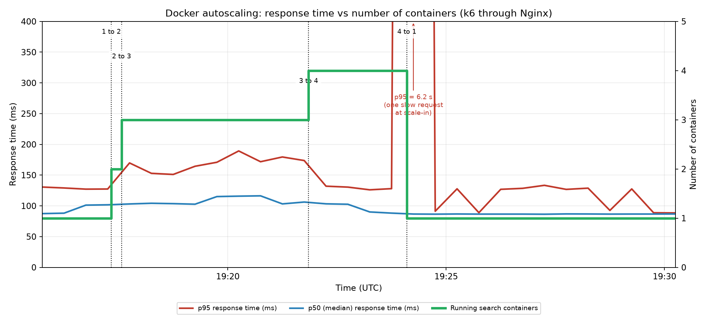
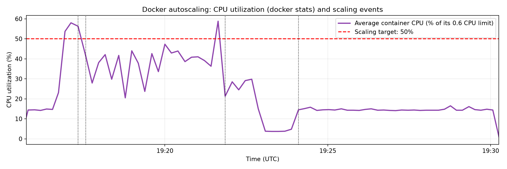
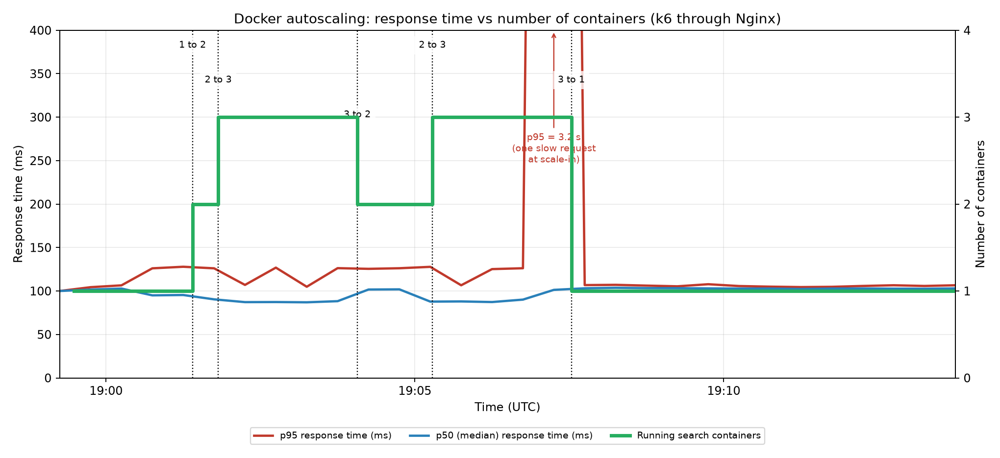

# Docker autoscaling demo: how it is built, how k6 works, and what we measured

This is the **local, Docker-only** companion to the AWS assignment. It runs on one laptop (WSL2, 8 CPUs), costs nothing, and shows the same idea: add copies of a service when CPU is high, remove them when it is low.

> **Important and honest point for the viva:** Docker, Docker Compose and Docker Swarm have **no built-in autoscaler**. What Docker gives us is the ability to run N identical containers (`--scale`). The *decision* to change N comes from a small script I wrote (`scripts/docker-autoscaler.sh`). On AWS that decision is made by the Auto Scaling Group; on Kubernetes it would be the Horizontal Pod Autoscaler. Kubernetes was **not** done.

## 1. How it is built

```
 k6 (load) ---> Nginx :18081 ---> search container 1 \
                  (gateway)  ---> search container 2  } (Postgres also runs, but Search does not use it)
                             ---> search container N /
                                      ^
        docker-autoscaler.sh reads CPU every 10 s, runs: docker compose up --scale search=N
```

| Piece | File | What it does |
|---|---|---|
| Compose stack | `docker/compose.autoscale.yaml` | Defines `postgres`, `search` (scalable, **CPU limit 0.6 per container**) and `gateway` (Nginx). No fixed container name or host port on `search`, so several copies can exist. |
| Load balancer | `docker/nginx.autoscale.conf` | Nginx forwards `/` to `http://search:8000`. Docker's internal DNS (`127.0.0.11`) returns the address of **every** `search` container. Using a variable in `proxy_pass` plus `resolver ... valid=2s` makes Nginx re-resolve every 2 seconds, so new containers start receiving traffic and removed ones stop, without reloading Nginx. |
| Database | `postgres` service | Started so the stack matches the full application, but the **Search service does not use it** (it generates its listings in memory), so it was idle in these runs. |
| Autoscaler | `scripts/docker-autoscaler.sh` | Control loop (below). |
| Results | `results/evidence/docker_p5_*`, `docker_p8_*` | Measured data. Graphs in `reports/figures/docker_p*_*.png`. |

### The autoscaler rule (same formula the Kubernetes HPA uses)

Every 10 seconds:
1. List the `search` containers; read each one's CPU from `docker stats`.
2. **Utilization** = average of (container CPU% ÷ its CPU limit). A container limited to 0.6 CPU that is using 0.3 CPU is at 50%.
3. **Desired containers** = `ceil(current × utilization ÷ 50)`, kept between 1 and 5. Changes smaller than 10% are ignored.
4. **Scale out** immediately. **Scale in** only after the lower number has been wanted for 120 seconds (to avoid flapping).
5. To apply it: `docker compose -p airbnb-autoscale -f docker/compose.autoscale.yaml up -d --no-recreate --scale search=N search`.

## 2. How to run it yourself (WSL)

```bash
cd ~/AirBnB_Cloud_Project
# 1. start the stack with one search container
docker compose -p airbnb-autoscale -f docker/compose.autoscale.yaml up -d --build
curl http://localhost:18081/health            # should return {"status": ...} once it is up (30-60 s)
curl "http://localhost:18081/search?city=Goa&limit=2"

# 2. terminal A: start the autoscaler (prints one line per 10 s and writes a CSV)
./scripts/docker-autoscaler.sh

# 3. terminal B: generate load with k6 (1 req/s, ramp to 8 req/s, hold 5 min, drop)
k6 run -e BASE_URL=http://localhost:18081 -e NORMAL_RPS=1 -e PEAK_RPS=8 \
       -e WARM_S=60 -e RAMP_S=60 -e HOLD_S=300 -e DOWN_S=30 -e COOL_S=420 loadtest/k6/search-spike.js

# 4. terminal C: watch the containers appear and disappear
watch -n 2 'docker compose -p airbnb-autoscale -f docker/compose.autoscale.yaml ps'
docker stats                                   # live CPU per container

# 5. clean up
docker compose -p airbnb-autoscale -f docker/compose.autoscale.yaml down -v
```
The run takes about 15 minutes. Ports used: **18081** (gateway). Your other local stack on 8080 is not affected.

## 3. How k6 works (and what "users" and "requests per second" mean)

k6 is a load-testing tool. You write a JavaScript file (`loadtest/k6/search-spike.js`) whose `default function` is **one iteration**: here, one `GET /search?...` request plus a check that the status is 200. k6 runs that function over and over using **virtual users (VUs)**: lightweight workers that each run iterations one after another.

There are two ways to decide how much load to send:

| Model | k6 executor | How load is controlled | Behaviour when the server is slow |
|---|---|---|---|
| **Closed** (users) | `constant-vus`, `ramping-vus` | You set the number of VUs. Each VU waits for its response, then sends the next request. | Throughput **falls** when the server slows, which hides overload. |
| **Open** (rate) — **what I used** | `ramping-arrival-rate` | You set requests per second. k6 starts new iterations on schedule regardless of how slow the server is. | The queue builds up and latency rises, like real crowds arriving. If k6 runs out of VUs it records `dropped_iterations`. |

I used the **open model** because a holiday spike is people arriving, not a fixed set of people waiting politely.

### The stages in `search-spike.js`

```js
stages: [
  { target: NORMAL, duration: 'WARM_S' },   // steady normal traffic
  { target: PEAK,   duration: 'RAMP_S' },   // ramp up to the peak
  { target: PEAK,   duration: 'HOLD_S' },   // hold the peak
  { target: NORMAL, duration: 'DOWN_S' },   // drop back
  { target: NORMAL, duration: 'COOL_S' },   // long quiet period so scale-in can happen
]
```
`preAllocatedVUs` (60) are created in advance; `maxVUs` (400) is the cap.

### How many "users" is that?

k6 reports requests per second, not people. Two useful conversions:

1. **Concurrent requests (what the server feels)** ≈ requests per second × response time (Little's law). Docker peak: 8 req/s × 0.11 s ≈ **1 request in flight** at a time. AWS peak: 16 req/s × 0.37 s (median) to 0.7 s (p95) ≈ **6 to 11 in flight** while one instance was struggling.
2. **Real people (an assumption, not measured):** if one person sends a request about every 10 seconds, then **req/s × 10 ≈ active people**. So **8 req/s ≈ 80 people** and **16 req/s ≈ 160 people** browsing at the same time. Change "10 seconds" and the answer scales proportionally.

### What the k6 output means

| Metric | Meaning |
|---|---|
| `http_reqs` | Total requests and average rate |
| `http_req_duration` | Response time: avg, median (`med`), p90, **p95** (95% of requests were faster than this), max |
| `http_req_failed` | Share of failed requests |
| `checks` | Our own pass/fail test (`status is 200`) |
| `dropped_iterations` | Iterations k6 could not start in time (not enough VUs) |
| `--out csv=...` | Saves **every** request with a timestamp, which I bucket into 30-second windows for the graphs |
| `--summary-export` | Saves the totals as JSON |

## 4. Numbers used

| Experiment | Where | Normal rate | Peak rate | Peak held | Per-container/instance limit |
|---|---|---|---|---|---|
| E1, E2 (AWS) | `t3.micro` behind an ALB | 4 req/s | **16 req/s** | 10 min | 2 vCPU; capacity measured at about **15 req/s** |
| Docker run 1 | containers behind Nginx | 1 req/s | **5 req/s** | 5 min | 0.6 CPU |
| Docker run 2 | containers behind Nginx | 1 req/s | **8 req/s** | 5 min | 0.6 CPU |

The Docker rates are lower because a 0.6-CPU container has much less CPU than a whole `t3.micro`. The point is the scaling behaviour, not matching AWS throughput.

## 5. Results (measured)

### Docker run 2: 8 requests per second



| Time (UTC) | Event |
|---|---|
| 19:15:30 | Start, 1 container |
| 19:17:07 | Average CPU 58% (above 50%) → autoscaler starts a 2nd container |
| 19:17:20 | CPU still 56% → 3rd container |
| 19:21:38 | CPU 59% → 4th container |
| 19:23:53 | Traffic is back to 1 req/s, CPU 5% → scale-in to **1** container |

Totals: **3,284 requests, 0 failed**, average 112 ms, median 101 ms, p95 154 ms. During the peak, p95 sat around 150–190 ms against about 130 ms at low load.



### Docker run 1: 5 requests per second



| Time (UTC) | Event |
|---|---|
| 19:01:10 | CPU 58% → 2nd container |
| 19:01:36 | CPU 59% → 3rd container |
| 19:03:50 | Reading dropped, so it **scaled in to 2** |
| 19:05:04 | CPU back to 57% → **3 again** |
| 19:07:19 | Traffic low → scale-in to 1 |

Totals: **2,249 requests, 0 failed**, median 101 ms, p95 126 ms.

### What to say about these results, honestly

- **The scaling mechanism works:** containers are added when CPU is above 50% and removed after the load falls. All requests succeeded.
- **There is no dramatic latency improvement.** Even one 0.6-CPU container handled 8 req/s without queuing, because this laptop's CPU is fast. The slowdown at the peak was small (p95 about 130 → 150–190 ms). The AWS experiment is the one that shows a large latency effect (p95 1.3 s → 0.27 s), because a `t3.micro` was truly overloaded.
- **Flapping in run 1** (3 → 2 → 3): with 2 containers the CPU would be about 55%, above the 50% target, so removing one was wrong. A real Kubernetes HPA waits and uses the highest recommendation in its stabilization window; my 60-line script does not. I did not fix this.
- **One slow request at each final scale-in** (3.2 s in run 1, 6.2 s in run 2). These are consistent with Nginx briefly sending a request to a container that had just been removed and waiting out its 3-second connect timeout once or twice (3.2 ≈ one timeout, 6.2 ≈ two). That is my likely explanation; I did not verify it. Real autoscalers drain connections before removing a target (the AWS ALB does this).
- **I could not count requests per container** to prove an even spread: removed containers lose their logs, so only the survivor could be counted (1,212 and 1,408 requests, i.e. the last container only).
- **Limits:** one run each; the load generator, Nginx, Postgres and the containers all share one machine, so they compete for CPU; Docker's CPU readings are instantaneous samples and noisy.

## 6. Likely viva questions

**Q: Does Docker autoscale?** No. Docker can run N copies (`--scale`), but something else must decide N. Here it is my script; on AWS it is the Auto Scaling Group; on Kubernetes the HPA.

**Q: How does Nginx find the new containers?** Docker's internal DNS name `search` resolves to all running copies. Nginx re-resolves every 2 seconds because the target is a variable.

**Q: Why is utilization measured against 0.6 CPU?** Without a limit a container could use all 8 CPUs, and "50%" would mean nothing. The limit makes 50% = 0.3 CPU.

**Q: What is p95?** 95% of requests were faster than this value; it shows the slow tail that averages hide.

**Q: Why requests per second and not "100 users"?** The server only feels the request rate and concurrency. Users are converted by assuming how often each one clicks.

**Q: Why would you still use AWS?** The AWS ALB drains connections, health-checks instances, replaces failed ones and scales across machines; this Docker demo scales only on one host.
