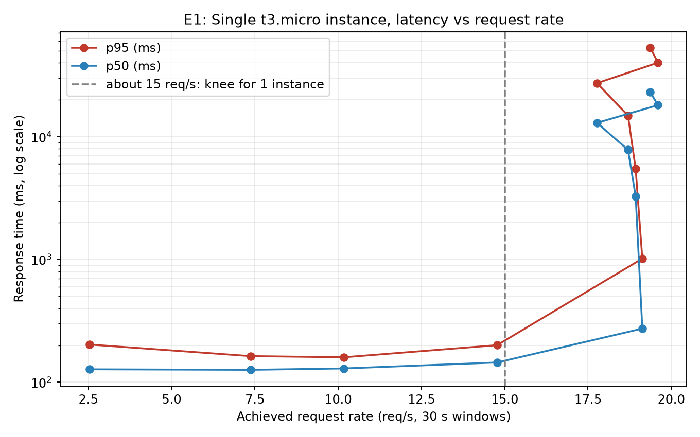
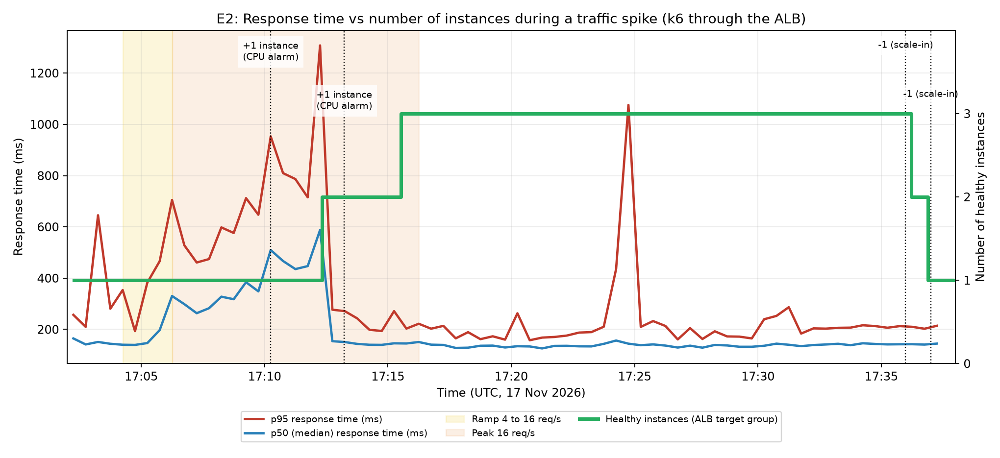
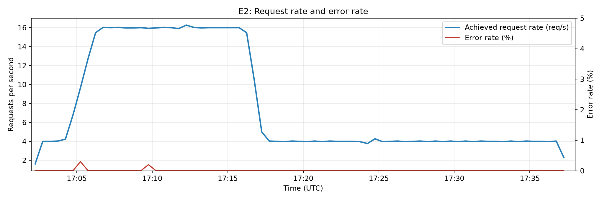

# Scalability and High-Traffic Events: Auto Scaling the Airbnb PoC on AWS

**Theme 1 — Scalability & High-Traffic Events (Hotstar, IRCTC, Flipkart)**
Project: Airbnb-style service-oriented PoC · Region: ap-south-1 (Mumbai) · Test date: 17 Nov 2026 (all times UTC)

> **How to read this report.** Everything labelled **MEASURED** comes from the saved raw data in `results/` (k6 output, CloudWatch, the Auto Scaling activity history and our own 15-second monitor). Everything labelled **ESTIMATE** is a calculation or a price assumption and was not measured.

---

## 1. Problem statement and objective

Holiday and sale events (Hotstar, IRCTC Tatkal, Flipkart) produce sudden traffic spikes of many times the normal load. A fixed number of servers is either too small (slow or failing during the spike) or too large (wasted money the rest of the time).

**Objective:** show that infrastructure on AWS automatically **adds servers when CPU goes above 50%** and **removes them when traffic drops**, using the existing Airbnb PoC application behind a load balancer, and show **response time against instance count** with real load-test data.

### Assignment deliverables and where they are

| # | Deliverable | Status | Where |
|---|---|---|---|
| 1 | Live URL of a Load Balancer returning a response | Done (MEASURED) while the stack is up | Section 4 |
| 2 | ASG dashboard screenshots showing instances launching | Console screenshots to be added by the author (the AWS console login is needed). The ASG activity history is already saved as raw data. | `screenshots/`, `results/evidence/asg_scaling_activities.json` |
| 3 | Load-testing report with response time vs instance count | Done (MEASURED) | Section 7, `reports/figures/e2_response_time_vs_instances.png` |
| + | Companion: Docker autoscaling with Nginx (extra, not required by the brief) | Done (MEASURED); Kubernetes not done | Section 8, `reports/DOCKER_AUTOSCALING_GUIDE.md` |

---

## 2. Architecture

```
                         Internet
                             |
                  +----------v-----------+
                  |  Application Load    |   HTTP :80
                  |  Balancer (2 AZs)    |   path rules: /search*, /listings*,
                  +----------+-----------+   /bookings*, /monolith*  (default: 404)
                             | /search*
                  +----------v-----------+
                  | Target group         |   health check: GET /health -> 200
                  | airbnb-soa-poc-      |   every 20 s, 3 failures = unhealthy
                  | search-tg            |
                  +----------+-----------+
                             |
          +------------------v-------------------+
          | Auto Scaling Group (search)          |   min 1, desired 1, max 3
          | t3.micro, Amazon Linux 2023          |   target tracking: average CPU = 50%
          | Docker container from ECR :latest    |   health check type: ELB
          | uvicorn, 2 workers, port 8000        |   IMDSv2 required
          +------------------+-------------------+
                             |  port 5432 (private subnets only)
                  +----------v-----------+
                  | RDS PostgreSQL       |   db.t3.micro, single-AZ
                  | (shared by all       |   not publicly accessible
                  |  instances)          |
                  +----------------------+
```

### Technology stack

| Layer | Technology |
|---|---|
| Application | Python 3.12, FastAPI, uvicorn (search, listing, booking services) |
| Containers | Docker, one image per service, stored in Amazon ECR |
| Compute | EC2 `t3.micro` (2 vCPU, 1 GB) in an EC2 Auto Scaling Group via a Launch Template |
| Load balancing | AWS Application Load Balancer (layer 7) |
| Database | Amazon RDS for PostgreSQL (shared state) |
| Infrastructure as code | Terraform 1.9.8 (`infra/terraform/`) |
| Monitoring | Amazon CloudWatch, plus a custom 15-second sampler (`scripts/monitor-asg.sh`) |
| Load testing | k6 0.54.0 (`loadtest/k6/`) |
| Analysis | Python (stdlib bucketing, matplotlib for graphs) |

### Application architecture and why it can scale horizontally

- The services keep **no local state**: no sessions, no uploads, no files. Search keeps a read-only, deterministically generated dataset in memory.
- All data that must be consistent (listings, bookings) lives in **PostgreSQL**. Every instance connects to the **same RDS database**, so adding instances adds capacity without splitting data.
- The first instance to start creates the schema and seeds the dataset. Seeding takes a database advisory lock and uses `ON CONFLICT DO NOTHING`, so several instances starting at once cannot corrupt it.
- **Redis is not used in this deployment** (`create_redis = false`). Redis is only a read cache; dropping it affects speed, not correctness.
- **Bookings are written directly to the database** (`booking_async = false`), so the SQS queue (created by Terraform) is unused here.

> A single EC2 host running the Docker Compose stack (as in the separate demo instance) could **not** simply be copied behind a load balancer: each copy would have its own empty Postgres. Sharing one RDS database is what makes multi-instance scaling correct.

---

## 3. Terraform configuration summary

Code: `infra/terraform/`. Profile used: `terraform.tfvars.assignment.example`.

| Resource | Configuration |
|---|---|
| VPC | 2 public + 2 private subnets in 2 AZs, internet gateway, no NAT gateway (cost) |
| Security groups | ALB: HTTP 80 from anywhere. App: port 8000 **only from the ALB**. Database: 5432 **only from the app group**. No SSH ingress. |
| Load balancer | ALB, HTTP listener on 80, one target group + path rule per service, default action 404 |
| Launch template | `t3.micro`, Amazon Linux 2023, **IMDSv2 required**, detailed monitoring, user-data installs Docker, logs in to ECR, runs the container with `--restart unless-stopped` |
| Auto Scaling Group | min 1 / desired 1 / max 3, ELB health checks, grace 240 s |
| Scaling policy | `TargetTrackingScaling`, metric `ASGAverageCPUUtilization`, **target 50%**, instance warm-up 120 s, default cooldown 300 s |
| Database | RDS PostgreSQL `db.t3.micro`, single-AZ, 20 GB gp3, encrypted, **not public** |
| Images | 4 ECR repositories (search, listing, booking, monolith), scan on push |
| Access | IAM role: ECR read-only + SSM Session Manager (no SSH keys) |
| Tags | Every resource tagged `Project = airbnb-soa-poc` |

The ASG scaling policy as deployed is saved in `results/evidence/asg_policies.json`.

### Why only the Search service was deployed

The Search service is the CPU-bound one (about 80 ms of CPU work per request by design), so it is the one that demonstrates CPU-based scaling.

**Quota constraint (MEASURED):** the account's EC2 quota "Running On-Demand Standard instances" is **8 vCPU**. The separate demo EC2 (`t3.small`) already uses **2 vCPU**, leaving **6 vCPU**. A `t3.micro` has 2 vCPU, so only **3 instances** fit. Running Search at up to 3 instances used the whole allowance, so the **Listing and Booking Auto Scaling Groups were set to 0 instances** (and the monolith ASG, which exists only for a separate experiment, was also 0). No quota increase was requested.

Consequences, stated plainly:
- **The Listing and Booking endpoints were not deployed behind the ALB and were not tested through it.** `/listings/*` returns HTTP 503 on the ALB because its target group is empty.
- Those endpoints were tested only earlier on the separate single-instance demo server (health, search, listing, booking), which is not part of this assignment stack.

---

## 4. Live URL (Deliverable 1)

```
http://airbnb-soa-poc-alb-1748194001.ap-south-1.elb.amazonaws.com/search?city=Goa&limit=5
```

MEASURED: this returned HTTP 200 with JSON search results from the 50,000-row dataset once the first target became healthy. The URL only works **while the stack exists**; it stops working after `terraform destroy`. (`/health` on the ALB returns 404 by design, because only the service paths are routed; the health check hits `/health` on each instance directly.)

---

## 5. Load-testing methodology

- **Tool:** k6, scripts in `loadtest/k6/`. Traffic originates from the author's own computer in WSL over the public internet to the ALB DNS name, so measured latency **includes the network path** (about 130 ms median at low load).
- **Request:** `GET /search?city=Goa&max_price=8000&min_rating=3.5&limit=20`.
- **Open-model load** (`ramping-arrival-rate`): k6 sends a fixed number of requests per second regardless of how slow the server is, which is how a real traffic spike behaves.
- **Recorded:** every request (k6 CSV), a k6 summary, a **15-second sample of ASG and target-group state** (UTC), CloudWatch metrics (1-minute CPU, in-service instances, ALB metrics) and the Auto Scaling activity history. Latency is bucketed in 30-second windows (`analysis/bucket_k6.py`).
- **Not done / not claimed:** no manual instance launches or capacity changes were made during the tests. Scaling in both experiments was by the Auto Scaling policy.

---

## 6. E1 — single-instance capacity (MEASURED)

Stepped ramp from 5 up to 30 requests per second against one instance (`fixed-capacity.js`, 16:39:16 to 16:45:19).



| Achieved rate (req/s) | p50 | p95 | Errors |
|---|---|---|---|
| about 2.5 – 7 | 126 – 128 ms | 163 – 203 ms | 0% |
| about 10 | 130 ms | 160 ms | 0% |
| about 15 | 145 ms | 200 ms | 0% |
| about 19 | 273 ms | 1,015 ms | 0% |
| about 19 (next 30 s) | 3.3 s | 5.5 s | 0% |
| about 19 (2 min later) | 18 s | 40 s | 0.7% |

**Result: one `t3.micro` serves about 15 requests per second** of this workload with p95 near 200 ms. Above roughly 17 to 19 requests per second the queue grows without bound and latency collapses.

### The E1 health-check failure and the Auto Scaling replacement

E1 overloaded the single instance, which turned into a real failure and recovery. From the ASG activity history and the monitor samples:

| Time (UTC) | Event |
|---|---|
| 16:43:15 | Monitor: healthy targets drops from 1 to **0** (the instance stopped answering `/health` in time) |
| 16:43:57 | ASG: instance `i-0e467d94...` **terminated "in response to an ELB system health check failure"** |
| 16:43:58 | ASG: replacement instance `i-015e58c9...` launched ("an unhealthy instance needing to be replaced") |
| 16:44:03 | CloudWatch `TargetTracking ... AlarmHigh` in ALARM |
| 16:44:09 | ASG: **additional instance** `i-0a34afc0...` launched by the CPU target-tracking policy |
| 16:45 (end of E1) | k6 totals: 7,231 requests, **31.8% failed**, overall p95 24.5 s |
| 17:01:58 | ASG: scale-in back to 1 instance (low-CPU alarm), automatic |

What this shows: when a single instance was driven far past its capacity, the load balancer's health check detected the failure and Auto Scaling **replaced the unhealthy instance and added capacity automatically**. It also shows the cost of reacting late: the failure happened first, and capacity arrived afterwards. These E1 numbers are **not** used for the response-time-vs-instances graph because the run mixes overload, failure and replacement.

---

## 7. E2 — traffic spike and automatic scaling (MEASURED)

Search-only spike (`search-spike.js`), start 17:02:16, end 17:37:20. Rates: 4 req/s for 2 minutes, ramp over 2 minutes to **16 req/s** (just above the one-instance capacity of about 15), hold for 10 minutes, drop back to 4 req/s for 21 minutes. **Starting state:** one in-service instance.

### The mandatory graph: response time vs number of instances



How to read it: the **green line** is the number of healthy instances behind the load balancer (right axis); the **red line** is p95 response time and the **blue line** the median (left axis, milliseconds); orange shading is the peak-load period; dotted vertical lines are Auto Scaling events.

### Response time by instance count at peak load (about 16 req/s)

| Healthy instances | 30-second windows | Median of p50 | Median of p95 | Worst p95 |
|---|---|---|---|---|
| 1 | 12 | 366 ms | 680 ms | 1,308 ms |
| 2 | 6 | 145 ms | 257 ms | 277 ms |
| 3 | 1 | 145 ms | 203 ms | 203 ms |


Data: `results/evidence/e2_latency_by_instance_count.csv`. Note the sample size: only one 30-second peak-load window had three instances, because the third instance became healthy near the end of the peak. The one-vs-two difference rests on 12 and 6 windows.

### Scaling event timeline (from the ASG activity history and monitor samples)

| Time (UTC) | Event | Source |
|---|---|---|
| 17:02:16 | k6 starts; 1 in-service instance | monitor |
| 17:04:16 – 17:06:16 | Ramp from 4 to 16 req/s | k6 schedule |
| about 17:07 | Average CPU rises above 50% (about 76% for the next ~5 min) | CloudWatch |
| 17:10:03 | `TargetTracking ... AlarmHigh` in ALARM | ASG activity |
| **17:10:15** | **ASG launches instance #2** (desired 1 → 2) | ASG activity |
| 17:12:20 | Instance #2 healthy in the target group | monitor |
| 17:12:30 | p95 drops from 1.3 s to about 275 ms | k6 |
| 17:13:03 | `AlarmHigh` in ALARM again | ASG activity |
| **17:13:14** | **ASG launches instance #3** (desired 2 → 3) | ASG activity |
| 17:15:32 | 3 healthy targets | monitor |
| 17:16:16 | Load drops back to 4 req/s | k6 schedule |
| 17:35:49 / **17:35:59** | `AlarmLow` → **ASG terminates one instance** (3 → 2) | ASG activity |
| 17:36:49 / **17:37:00** | `AlarmLow` → **ASG terminates another** (2 → 1) | ASG activity |




### E2 totals (k6 summary)

16,679 requests, **2 failed (0.01%)**, average 243 ms, median 160 ms, p90 499 ms, **p95 623 ms**, maximum 7.07 s.

### Observations (including what is not explained)

1. **Scale-out lagged the traffic.** CPU crossed 50% at about 17:07 but the first new instance launched at 17:10:15, and it served traffic about 2 minutes later. Target tracking waits for several consecutive 1-minute readings above the target, then the instance must boot, pull its image and pass two health checks. During that window users saw p95 of 0.5–1.3 s instead of about 200 ms.
2. **A third instance was launched although average CPU had already fallen to about 45%.** A plausible explanation is that the `AlarmHigh` alarm was still evaluating earlier high readings; I did not verify this in the alarm history.
3. **Scale-in is deliberately slow.** The instances were removed about 19 minutes after load fell. AWS target tracking keeps the capacity until CPU has stayed low for roughly 15 minutes, to avoid flapping.
4. **One unexplained latency spike** at about 17:24:45 (p95 about 1.08 s) occurred at 4 req/s with 3 healthy instances and 0% errors. I did not investigate its cause (possibilities include a network blip on the test path); it is shown as measured.
5. A direct health-check failure did not recur in E2, because the peak (16 req/s) was only slightly above single-instance capacity, unlike E1.

---

## 8. Companion experiment: autoscaling with Docker on one machine (MEASURED)

The same idea was reproduced locally with Docker, with **Nginx** as the load balancer instead of the AWS Application Load Balancer. This costs nothing and shows the mechanism in a form that is easy to inspect. Full details, commands and an explanation of k6 are in `reports/DOCKER_AUTOSCALING_GUIDE.md`. **Kubernetes was not implemented.**

### How the two setups compare

| | AWS (main experiment) | Docker (companion) |
|---|---|---|
| Load balancer | **AWS Application Load Balancer** (managed, layer 7, health checks, connection draining) | **Nginx** container, routes `/` to `http://search:8000`; Docker DNS returns every replica and Nginx re-resolves every 2 s |
| Unit that is scaled | EC2 instance (`t3.micro`, 2 vCPU) | Container (CPU limit 0.6) |
| Who decides to scale | **EC2 Auto Scaling Group**, target tracking (CloudWatch alarms) | **My script** `scripts/docker-autoscaler.sh` (Docker has no built-in autoscaler) |
| Rule | Average CPU 50% | Average CPU 50% of the container limit, `ceil(current × utilization ÷ 50)`, 1 to 5 containers |
| Scale-in delay | about 15 min of low CPU (AWS rule) | 120 s of low reading (my setting) |
| Shared database | RDS PostgreSQL | PostgreSQL container |
| Cost | about $0.10 – 0.16 per hour (estimate) | none |
| Health checks and replacement | Yes (ALB + ASG replaced a failed instance in E1) | No |

### Results

| Run | Peak rate | Containers over time | Requests | Failed | Median | p95 |
|---|---|---|---|---|---|---|
| Docker 1 | 5 req/s | 1 → 2 → 3 → 2 → 3 → 1 | 2,249 | 0 | 101 ms | 126 ms |
| Docker 2 | 8 req/s | 1 → 2 → 3 → 4 → 1 | 3,284 | 0 | 101 ms | 154 ms |


(Run 1 graphs: `figures/docker_p5_*.png`. Data: `results/evidence/docker_p5_*`, `docker_p8_*`.)

Run 2 timeline (UTC): 19:17:07 CPU 58% → 2nd container; 19:17:20 CPU 56% → 3rd; 19:21:38 CPU 59% → 4th; 19:23:53 load back to 1 req/s (CPU 5%) → back to 1 container.

### Honest reading of the Docker results

- The scaling mechanism worked and every request succeeded.
- **Latency barely changed**: one 0.6-CPU container on this fast laptop coped with 8 req/s, so p95 only moved from about 130 ms to 150 – 190 ms. The large latency effect is in the AWS experiment (Section 7), where a real `t3.micro` was overloaded.
- Run 1 **flapped** (3 → 2 → 3): with 2 containers CPU would sit above the 50% target. A Kubernetes HPA would smooth this; my script does not.
- One slow request at each final scale-in (3.2 s and 6.2 s), consistent with Nginx briefly sending a request to a removed container and waiting out its 3 s connect timeout once or twice. This is my likely explanation, not verified. The AWS ALB drains connections to avoid this.
- Requests per container could not be counted (removed containers lose their logs), so an even spread is **not** proven by a count.
- One run per rate; the load generator, Nginx, Postgres and containers share one machine.

---

## 9. Screenshots

I cannot capture screenshots (they need your signed-in browser or terminal). Save yours in `screenshots/` using these names, so the report and viva refer to the same files.

### A. AWS console and browser (Deliverable 2)

| File | What to capture | Why it matters |
|---|---|---|
| `01-alb-url-response.png` | Browser showing the live `/search?city=Goa&limit=5` response, with the ALB DNS name visible in the address bar | Deliverable 1: live URL through the load balancer |
| `02-alb-details.png` | EC2 → Load balancers → the ALB (DNS name, listener on port 80, listener rules) | Shows the load balancer exists |
| `03-target-group-healthy.png` | Target group `airbnb-soa-poc-search-tg` → Targets tab: instances **healthy** | Shows health checks and registration |
| `04-asg-overview.png` | ASG `airbnb-soa-poc-search-asg` → Details: min 1, desired, max 3 | Shows the scaling limits |
| `05-asg-activity-history.png` | ASG → **Activity** tab: "Launching a new EC2 instance" and "Terminating EC2 instance" rows with their causes | **Main proof of automatic scale-out and scale-in** |
| `06-asg-scaling-policy.png` | ASG → Automatic scaling: target tracking policy, target value **50** | Shows the 50% CPU rule |
| `07-asg-monitoring.png` | ASG → Monitoring: CPU utilization and instance count graphs | CloudWatch evidence |
| `08-asg-instances.png` | ASG → Instance management: several InService instances | Shows more than one instance |
| `09-ec2-instances.png` | EC2 → Instances: the instances launched by the ASG (running, then terminated ones) | Instances launching automatically |

The Activity tab only keeps recent history, so if the screenshots are missing, the same events exist as raw data in `results/evidence/asg_scaling_activities.json`.

### B. Terminal screenshots to show how the tests were run

| File | What to capture |
|---|---|
| `10-k6-aws-e2-output.png` | The end of the k6 run (`results/raw/e2_k6_stdout.txt`): `http_reqs`, `http_req_duration` with p95, `http_req_failed` |
| `11-terraform-apply-complete.png` | `terraform apply` finishing with "Apply complete" (re-create the stack if you need this) |

### C. Docker autoscaling (requires re-running the demo, about 15 minutes; commands in the Docker guide)

| File | What to capture | Why |
|---|---|---|
| `12-docker-compose-ps-1.png` | `docker compose -p airbnb-autoscale -f docker/compose.autoscale.yaml ps` before the spike: **1** search container | Starting state |
| `13-docker-autoscaler-log.png` | The autoscaler terminal showing `scale_out` lines (replicas 1 → 2 → 3, CPU above 50) | Proof the script made the decision |
| `14-docker-compose-ps-3.png` | The same `ps` command at the peak: **3 or 4** search containers | Containers added |
| `15-docker-stats.png` | `docker stats` at the peak: CPU per container | CPU evidence |
| `16-docker-scale-in.png` | The autoscaler log showing `scale_in` and `ps` back to 1 container | Scale-in |
| `17-docker-k6-output.png` | The k6 summary for the Docker run | Load test evidence |
| `18-nginx-conf.png` | `docker/nginx.autoscale.conf` (the `resolver` and `proxy_pass http://$upstream:8000` lines) | Shows Nginx as the load balancer |

**Minimum set for the viva:** 01, 03, 05, 06, plus the graph `reports/figures/e2_response_time_vs_instances.png`. The rest are supporting evidence.

---

## 10. Limitations

- Only the **Search** service was deployed (8-vCPU quota); Listing and Booking were **not** tested through the ALB (Section 3).
- Traffic came from one home connection over the internet, so absolute latencies include network delay and the load generator could itself be a bottleneck at much higher rates.
- One run of each experiment (E1, E2) on one day; there are no repeated runs, so no confidence intervals. The 3-instance result rests on a single 30-second window.
- E1 was run to failure on purpose; it is a capacity probe, not a clean steady-state measurement.
- HTTP only (no TLS), single region, single-AZ database without backups. This is a PoC, not a production design.
- The peak load (16 req/s) is small in absolute terms; the demonstration is about the **shape** of the response (capacity added after CPU crossed the target, removed after load fell), not about large-scale throughput.
- Redis caching and asynchronous (SQS) booking were not exercised.
- The Docker companion (Section 8) uses a custom autoscaler script, not a Docker feature; it shows little latency change and flapped in run 1. Kubernetes autoscaling was not implemented.
- I did not verify alarm-history details beyond the ASG activity records (Observation 2).

---

## 11. Cost

**ESTIMATES** (ap-south-1, on-demand list prices from memory, not measured; check the Billing console for actuals):

| Item | Approximate |
|---|---|
| ALB | $0.03 / hour |
| RDS `db.t3.micro` + 20 GB storage | $0.02 / hour |
| `t3.micro` instances (1 to 3) | $0.012 each / hour |
| Public IPv4 addresses (instances + ALB) | $0.005 each / hour |
| **Whole stack, running** | **about $0.10 – 0.16 / hour** |

The stack was created at about 16:28 UTC on 17 Nov. Leaving it running for a month would cost roughly $90–110 (about the whole $100 credit), which is why it should be destroyed once the evidence is saved. No NAT gateway, Redis or load-generator instance was created. A separate demo `t3.small` (about $19/month) exists outside this stack.

---

## 12. Reproduction

See the repository `README.md` ("AWS autoscaling assignment: reproduce") for exact commands. In brief: configure an IAM user, copy `terraform.tfvars.assignment.example` to `terraform.tfvars`, apply only the ECR repositories, run `scripts/build-push.sh`, apply the rest, run k6 (`fixed-capacity.js`, `search-spike.js`) with `scripts/monitor-asg.sh` alongside, then `analysis/bucket_k6.py` and `analysis/report_plots.py`. For the Docker companion see `reports/DOCKER_AUTOSCALING_GUIDE.md` (`docker/compose.autoscale.yaml`, `scripts/docker-autoscaler.sh`, `analysis/docker_plots.py`).

## 13. Cleanup

The stack must be destroyed after the screenshots are saved and the raw data is backed up. **It has not been destroyed yet.**

```bash
cd infra/terraform
terraform destroy -var-file=terraform.tfvars   # review the list; type yes
```
This removes the ALB, ASGs and instances, launch templates, RDS database (no final snapshot), SQS queue, ECR repositories (with their images), VPC and the CloudWatch dashboard. It does **not** touch the separate demo EC2 (`i-0c09ab8dcb8b5a32f`), which is not managed by this Terraform state. Afterwards confirm in the console that no load balancer, RDS instance or Auto Scaling group remains, and detach the temporary IAM permissions.

## 14. Raw data and where it is

| Data | Location | In Git? |
|---|---|---|
| k6 per-request data (E1 26 MB, E2 56 MB) | `results/raw/e1_requests.csv`, `e2_requests.csv` | **No (back up manually)** |
| k6 per-request data, Docker runs | `results/raw/docker_p5_requests.csv`, `docker_p8_requests.csv` (large) | **No (back up manually)** |
| k6 console logs | `results/raw/e1_k6_stdout.txt`, `e2_k6_stdout.txt`, `docker_p5_k6_stdout.txt`, `docker_p8_k6_stdout.txt` | No |
| Docker summaries, buckets and autoscaler samples | `results/evidence/docker_p5_*`, `docker_p8_*` | Yes |
| k6 summaries, 30 s buckets, ASG samples, CloudWatch JSON, ASG activity history, run log | `results/evidence/` (account ID redacted) | Yes |
| Graphs | `reports/figures/` | Yes |
