# Scalability and High-Traffic Events: Auto Scaling the Airbnb PoC on AWS

**Theme 1 — Scalability & High-Traffic Events (Hotstar, IRCTC, Flipkart)**
Project: Airbnb-style service-oriented PoC · Region: ap-south-1 (Mumbai) · Test date: 17 Nov 2026 (all times UTC)

> **How to read this report.** Everything labelled **MEASURED** comes from the saved raw data in `results/` (k6 output, CloudWatch, the Auto Scaling activity history and our own 15-second monitor). Everything labelled **ESTIMATE** is a calculation or a price assumption and was not measured.

---

## 1. Problem statement and objective

Holiday and sale events (Hotstar, IRCTC Tatkal, Flipkart) produce sudden traffic spikes of many times the normal load. A fixed number of servers is either too small (slow or failing during the spike) or too large (wasted money the rest of the time).

**Objective:** show that infrastructure on AWS automatically **adds servers when CPU goes above 50%** and **removes them when traffic drops**, using the existing Airbnb PoC application behind a load balancer, and show **response time against instance count** with real load-test data.

### Assignment deliverables and where they are

| # | Deliverable | Status | Where |
|---|---|---|---|
| 1 | Live URL of a Load Balancer returning a response | Done (MEASURED) while the stack is up | Section 4 |
| 2 | ASG dashboard screenshots showing instances launching | **Done**: console screenshots of the ASG activity history, scaling policy, metrics, target group, load balancer and alarms | Section 9, `screenshots/`; raw data in `results/evidence/asg_scaling_activities.json` |
| 3 | Load-testing report with response time vs instance count | Done (MEASURED) | Section 7, `reports/figures/e2_response_time_vs_instances.png` |
| + | Companion: Docker autoscaling with Nginx (extra, not required by the brief) | Done (MEASURED); Kubernetes not done | Section 8, `reports/DOCKER_AUTOSCALING_GUIDE.md` |

---

## 2. Architecture

```
                         Internet
                             |
                  +----------v-----------+
                  |  Application Load    |   HTTP :80
                  |  Balancer (2 AZs)    |   path rules: /search*, /listings*,
                  +----------+-----------+   /bookings*, /monolith*  (default: 404)
                             | /search*
                  +----------v-----------+
                  | Target group         |   health check: GET /health -> 200
                  | airbnb-soa-poc-      |   every 20 s, 3 failures = unhealthy
                  | search-tg            |
                  +----------+-----------+
                             |
          +------------------v-------------------+
          | Auto Scaling Group (search)          |   min 1, desired 1, max 3
          | t3.micro, Amazon Linux 2023          |   target tracking: average CPU = 50%
          | Docker container from ECR :latest    |   health check type: ELB
          | uvicorn, 2 workers, port 8000        |   IMDSv2 required
          +------------------+-------------------+
                             |  port 5432 (private subnets only)
                  +----------v-----------+
                  | RDS PostgreSQL       |   db.t3.micro, single-AZ
                  | (shared by all       |   not publicly accessible
                  |  instances)          |
                  +----------------------+
```

### Technology stack

| Layer | Technology |
|---|---|
| Application | Python 3.12, FastAPI, uvicorn (search, listing, booking services) |
| Containers | Docker, one image per service, stored in Amazon ECR |
| Compute | EC2 `t3.micro` (2 vCPU, 1 GB) in an EC2 Auto Scaling Group via a Launch Template |
| Load balancing | AWS Application Load Balancer (layer 7) |
| Database | Amazon RDS for PostgreSQL (shared state) |
| Infrastructure as code | Terraform 1.9.8 (`infra/terraform/`) |
| Monitoring | Amazon CloudWatch, plus a custom 15-second sampler (`scripts/monitor-asg.sh`) |
| Load testing | k6 0.54.0 (`loadtest/k6/`) |
| Analysis | Python (stdlib bucketing, matplotlib for graphs) |

### Application architecture and why it can scale horizontally

- The services keep **no local state**: no sessions, no uploads, no files. Search keeps a read-only, deterministically generated dataset in memory.
- All data that must be consistent (listings, bookings) lives in **PostgreSQL**. Every instance connects to the **same RDS database**, so adding instances adds capacity without splitting data.
- The first instance to start creates the schema and seeds the dataset. Seeding takes a database advisory lock and uses `ON CONFLICT DO NOTHING`, so several instances starting at once cannot corrupt it.
- **Redis is not used in this deployment** (`create_redis = false`). Redis is only a read cache; dropping it affects speed, not correctness.
- **Bookings are written directly to the database** (`booking_async = false`), so the SQS queue (created by Terraform) is unused here.

> A single EC2 host running the Docker Compose stack (as in the separate demo instance) could **not** simply be copied behind a load balancer: each copy would have its own empty Postgres. Sharing one RDS database is what makes multi-instance scaling correct.

---

## 3. Terraform configuration summary

Code: `infra/terraform/`. Profile used: `terraform.tfvars.assignment.example`.

| Resource | Configuration |
|---|---|
| VPC | 2 public + 2 private subnets in 2 AZs, internet gateway, no NAT gateway (cost) |
| Security groups | ALB: HTTP 80 from anywhere. App: port 8000 **only from the ALB**. Database: 5432 **only from the app group**. No SSH ingress. |
| Load balancer | ALB, HTTP listener on 80, one target group + path rule per service, default action 404 |
| Launch template | `t3.micro`, Amazon Linux 2023, **IMDSv2 required**, detailed monitoring, user-data installs Docker, logs in to ECR, runs the container with `--restart unless-stopped` |
| Auto Scaling Group | min 1 / desired 1 / max 3, ELB health checks, grace 240 s |
| Scaling policy | `TargetTrackingScaling`, metric `ASGAverageCPUUtilization`, **target 50%**, instance warm-up 120 s, default cooldown 300 s |
| Database | RDS PostgreSQL `db.t3.micro`, single-AZ, 20 GB gp3, encrypted, **not public** |
| Images | 4 ECR repositories (search, listing, booking, monolith), scan on push |
| Access | IAM role: ECR read-only + SSM Session Manager (no SSH keys) |
| Tags | Every resource tagged `Project = airbnb-soa-poc` |

The ASG scaling policy as deployed is saved in `results/evidence/asg_policies.json`.

### Why only the Search service was deployed

The Search service is the CPU-bound one (about 80 ms of CPU work per request by design), so it is the one that demonstrates CPU-based scaling.

**Quota constraint (MEASURED):** the account's EC2 quota "Running On-Demand Standard instances" is **8 vCPU**. The separate demo EC2 (`t3.small`) already uses **2 vCPU**, leaving **6 vCPU**. A `t3.micro` has 2 vCPU, so only **3 instances** fit. Running Search at up to 3 instances used the whole allowance, so the **Listing and Booking Auto Scaling Groups were set to 0 instances** (and the monolith ASG, which exists only for a separate experiment, was also 0). No quota increase was requested.

Consequences, stated plainly:
- **The Listing and Booking endpoints were not deployed behind the ALB and were not tested through it.** `/listings/*` returns HTTP 503 on the ALB because its target group is empty.
- Those endpoints were tested only earlier on the separate single-instance demo server (health, search, listing, booking), which is not part of this assignment stack.

---

## 4. Live URL (Deliverable 1)

```
http://airbnb-soa-poc-alb-1748194001.ap-south-1.elb.amazonaws.com/search?city=Goa&limit=5
```

MEASURED: this returned HTTP 200 with JSON search results from the 50,000-row dataset once the first target became healthy. The URL only works **while the stack exists**; **the stack has since been destroyed (Section 13), so this URL no longer works.** (`/health` on the ALB returns 404 by design, because only the service paths are routed; the health check hits `/health` on each instance directly.)

---

## 5. Load-testing methodology

- **Tool:** k6, scripts in `loadtest/k6/`. Traffic originates from the author's own computer in WSL over the public internet to the ALB DNS name, so measured latency **includes the network path** (about 130 ms median at low load).
- **Request:** `GET /search?city=Goa&max_price=8000&min_rating=3.5&limit=20`.
- **Open-model load** (`ramping-arrival-rate`): k6 sends a fixed number of requests per second regardless of how slow the server is, which is how a real traffic spike behaves.
- **Recorded:** every request (k6 CSV), a k6 summary, a **15-second sample of ASG and target-group state** (UTC), CloudWatch metrics (1-minute CPU, in-service instances, ALB metrics) and the Auto Scaling activity history. Latency is bucketed in 30-second windows (`analysis/bucket_k6.py`).
- **Not done / not claimed:** no manual instance launches or capacity changes were made during the tests. Scaling in both experiments was by the Auto Scaling policy.

---

## 6. E1 — single-instance capacity (MEASURED)

Stepped ramp from 5 up to 30 requests per second against one instance (`fixed-capacity.js`, 16:39:16 to 16:45:19).


| Achieved rate (req/s) | p50 | p95 | Errors |
|---|---|---|---|
| about 2.5 – 7 | 126 – 128 ms | 163 – 203 ms | 0% |
| about 10 | 130 ms | 160 ms | 0% |
| about 15 | 145 ms | 200 ms | 0% |
| about 19 | 273 ms | 1,015 ms | 0% |
| about 19 (next 30 s) | 3.3 s | 5.5 s | 0% |
| about 19 (2 min later) | 18 s | 40 s | 0.7% |

**Result: one `t3.micro` serves about 15 requests per second** of this workload with p95 near 200 ms. Above roughly 17 to 19 requests per second the queue grows without bound and latency collapses.

### The E1 health-check failure and the Auto Scaling replacement

E1 overloaded the single instance, which turned into a real failure and recovery. From the ASG activity history and the monitor samples:

| Time (UTC) | Event |
|---|---|
| 16:43:15 | Monitor: healthy targets drops from 1 to **0** (the instance stopped answering `/health` in time) |
| 16:43:57 | ASG: instance `i-0e467d94...` **terminated "in response to an ELB system health check failure"** |
| 16:43:58 | ASG: replacement instance `i-015e58c9...` launched ("an unhealthy instance needing to be replaced") |
| 16:44:03 | CloudWatch `TargetTracking ... AlarmHigh` in ALARM |
| 16:44:09 | ASG: **additional instance** `i-0a34afc0...` launched by the CPU target-tracking policy |
| 16:45 (end of E1) | k6 totals: 7,231 requests, **31.8% failed**, overall p95 24.5 s |
| 17:01:58 | ASG: scale-in back to 1 instance (low-CPU alarm), automatic |

What this shows: when a single instance was driven far past its capacity, the load balancer's health check detected the failure and Auto Scaling **replaced the unhealthy instance and added capacity automatically**. It also shows the cost of reacting late: the failure happened first, and capacity arrived afterwards. These E1 numbers are **not** used for the response-time-vs-instances graph because the run mixes overload, failure and replacement.

---

## 7. E2 — traffic spike and automatic scaling (MEASURED)

Search-only spike (`search-spike.js`), start 17:02:16, end 17:37:20. Rates: 4 req/s for 2 minutes, ramp over 2 minutes to **16 req/s** (just above the one-instance capacity of about 15), hold for 10 minutes, drop back to 4 req/s for 21 minutes. **Starting state:** one in-service instance.

### The mandatory graph: response time vs number of instances


How to read it: the **green line** is the number of healthy instances behind the load balancer (right axis); the **red line** is p95 response time and the **blue line** the median (left axis, milliseconds); orange shading is the peak-load period; dotted vertical lines are Auto Scaling events.

### Response time by instance count at peak load (about 16 req/s)

| Healthy instances | 30-second windows | Median of p50 | Median of p95 | Worst p95 |
|---|---|---|---|---|
| 1 | 12 | 366 ms | 680 ms | 1,308 ms |
| 2 | 6 | 145 ms | 257 ms | 277 ms |
| 3 | 1 | 145 ms | 203 ms | 203 ms |

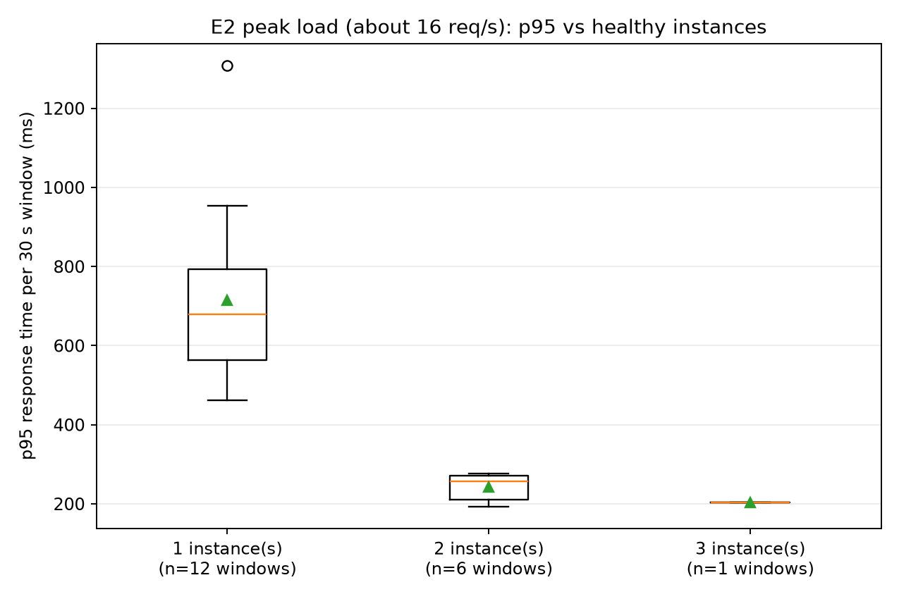

Data: `results/evidence/e2_latency_by_instance_count.csv`. Note the sample size: only one 30-second peak-load window had three instances, because the third instance became healthy near the end of the peak. The one-vs-two difference rests on 12 and 6 windows.

### Scaling event timeline (from the ASG activity history and monitor samples)

| Time (UTC) | Event | Source |
|---|---|---|
| 17:02:16 | k6 starts; 1 in-service instance | monitor |
| 17:04:16 – 17:06:16 | Ramp from 4 to 16 req/s | k6 schedule |
| about 17:07 | Average CPU rises above 50% (about 76% for the next ~5 min) | CloudWatch |
| 17:10:03 | `TargetTracking ... AlarmHigh` in ALARM | ASG activity |
| **17:10:15** | **ASG launches instance #2** (desired 1 → 2) | ASG activity |
| 17:12:20 | Instance #2 healthy in the target group | monitor |
| 17:12:30 | p95 drops from 1.3 s to about 275 ms | k6 |
| 17:13:03 | `AlarmHigh` in ALARM again | ASG activity |
| **17:13:14** | **ASG launches instance #3** (desired 2 → 3) | ASG activity |
| 17:15:32 | 3 healthy targets | monitor |
| 17:16:16 | Load drops back to 4 req/s | k6 schedule |
| 17:35:49 / **17:35:59** | `AlarmLow` → **ASG terminates one instance** (3 → 2) | ASG activity |
| 17:36:49 / **17:37:00** | `AlarmLow` → **ASG terminates another** (2 → 1) | ASG activity |

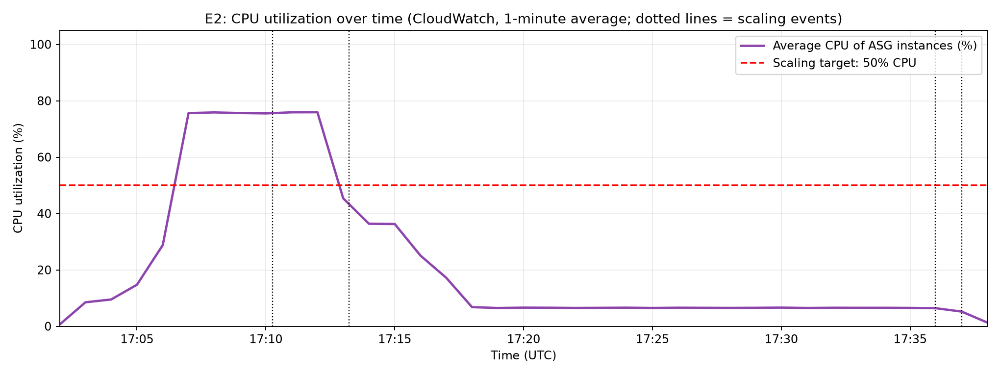


### E2 totals (k6 summary)

16,679 requests, **2 failed (0.01%)**, average 243 ms, median 160 ms, p90 499 ms, **p95 623 ms**, maximum 7.07 s.

### Observations (including what is not explained)

1. **Scale-out lagged the traffic.** CPU crossed 50% at about 17:07 but the first new instance launched at 17:10:15, and it served traffic about 2 minutes later. Target tracking waits for several consecutive 1-minute readings above the target, then the instance must boot, pull its image and pass two health checks. During that window users saw p95 of 0.5–1.3 s instead of about 200 ms.
2. **A third instance was launched although average CPU had already fallen to about 45%.** A plausible explanation is that the `AlarmHigh` alarm was still evaluating earlier high readings; I did not verify this in the alarm history.
3. **Scale-in is deliberately slow.** The instances were removed about 19 minutes after load fell. AWS target tracking keeps the capacity until CPU has stayed low for roughly 15 minutes, to avoid flapping.
4. **One unexplained latency spike** at about 17:24:45 (p95 about 1.08 s) occurred at 4 req/s with 3 healthy instances and 0% errors. I did not investigate its cause (possibilities include a network blip on the test path); it is shown as measured.
5. A direct health-check failure did not recur in E2, because the peak (16 req/s) was only slightly above single-instance capacity, unlike E1.

---

## 8. Companion experiment: autoscaling with Docker on one machine (MEASURED)

The same idea was reproduced locally with Docker, with **Nginx** as the load balancer instead of the AWS Application Load Balancer. This costs nothing and shows the mechanism in a form that is easy to inspect. Full details, commands and an explanation of k6 are in `reports/DOCKER_AUTOSCALING_GUIDE.md`. **Kubernetes was not implemented.**

### How the two setups compare

| | AWS (main experiment) | Docker (companion) |
|---|---|---|
| Load balancer | **AWS Application Load Balancer** (managed, layer 7, health checks, connection draining) | **Nginx** container, routes `/` to `http://search:8000`; Docker DNS returns every replica and Nginx re-resolves every 2 s |
| Unit that is scaled | EC2 instance (`t3.micro`, 2 vCPU) | Container (CPU limit 0.6) |
| Who decides to scale | **EC2 Auto Scaling Group**, target tracking (CloudWatch alarms) | **My script** `scripts/docker-autoscaler.sh` (Docker has no built-in autoscaler) |
| Rule | Average CPU 50% | Average CPU 50% of the container limit, `ceil(current × utilization ÷ 50)`, 1 to 5 containers |
| Scale-in delay | about 15 min of low CPU (AWS rule) | 120 s of low reading (my setting) |
| Shared database | RDS PostgreSQL | PostgreSQL container |
| Cost | about $0.10 – 0.16 per hour (estimate) | none |
| Health checks and replacement | Yes (ALB + ASG replaced a failed instance in E1) | No |

### Results

| Run | Peak rate | Containers over time | Requests | Failed | Median | p95 |
|---|---|---|---|---|---|---|
| Docker 1 | 5 req/s | 1 → 2 → 3 → 2 → 3 → 1 | 2,249 | 0 | 101 ms | 126 ms |
| Docker 2 | 8 req/s | 1 → 2 → 3 → 4 → 1 | 3,284 | 0 | 101 ms | 154 ms |

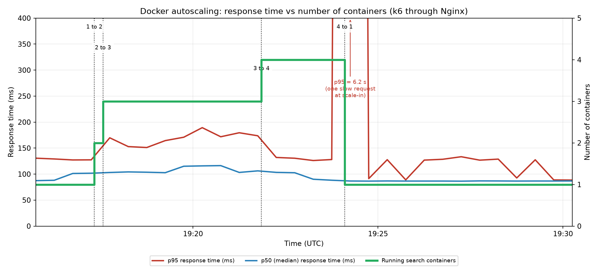
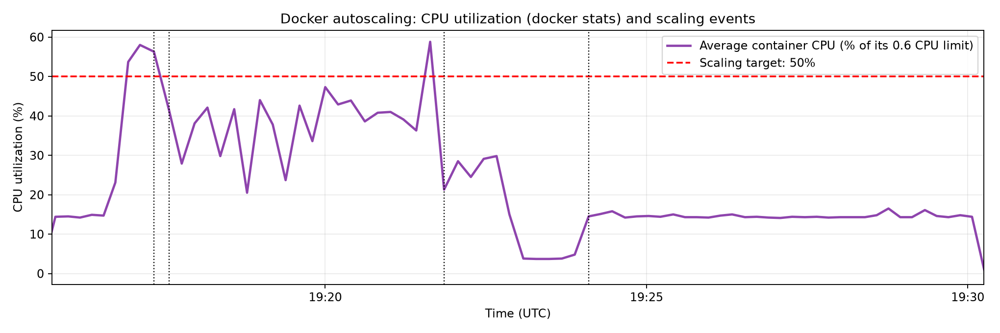

(Run 1 graphs: `figures/docker_p5_*.png`. Data: `results/evidence/docker_p5_*`, `docker_p8_*`.)

Run 2 timeline (UTC): 19:17:07 CPU 58% → 2nd container; 19:17:20 CPU 56% → 3rd; 19:21:38 CPU 59% → 4th; 19:23:53 load back to 1 req/s (CPU 5%) → back to 1 container.

### Honest reading of the Docker results

- The scaling mechanism worked and every request succeeded.
- **Latency barely changed**: one 0.6-CPU container on this fast laptop coped with 8 req/s, so p95 only moved from about 130 ms to 150 – 190 ms. The large latency effect is in the AWS experiment (Section 7), where a real `t3.micro` was overloaded.
- Run 1 **flapped** (3 → 2 → 3): with 2 containers CPU would sit above the 50% target. A Kubernetes HPA would smooth this; my script does not.
- One slow request at each final scale-in (3.2 s and 6.2 s), consistent with Nginx briefly sending a request to a removed container and waiting out its 3 s connect timeout once or twice. This is my likely explanation, not verified. The AWS ALB drains connections to avoid this.
- Requests per container could not be counted (removed containers lose their logs), so an even spread is **not** proven by a count.
- One run per rate; the load generator, Nginx, Postgres and containers share one machine.

---

## 9. Evidence: screenshots from the AWS console, browser and terminal (Deliverable 2)

These are the author's own screenshots, taken during the experiment on 17 Nov 2026. The AWS account number visible in the console header and in ARNs has been **blacked out** in three of them; nothing else was altered. All files are in `screenshots/`. Timestamps in the Auto Scaling activity text are **UTC**; the console's "Date created" for the load balancer is shown in the author's local time (UTC+05:30).

### 9.1 The live URL answering through the load balancer (Deliverable 1)

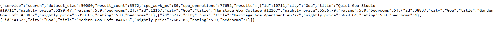

**What it shows:** the browser response from `http://airbnb-soa-poc-alb-1748194001.ap-south-1.elb.amazonaws.com/search?city=Goa&limit=...`, a JSON document from the Search service: `"service":"search"`, `"dataset_size":50000`, `"result_count":3572` listings in Goa, and the first five results (id, city, title, nightly price, rating, bedrooms). **Why it matters:** this is a real response that came **through the Application Load Balancer** from an EC2 instance in the Auto Scaling Group, not from a laptop. (The stack has since been destroyed, so the link no longer works.)

### 9.2 The load balancer

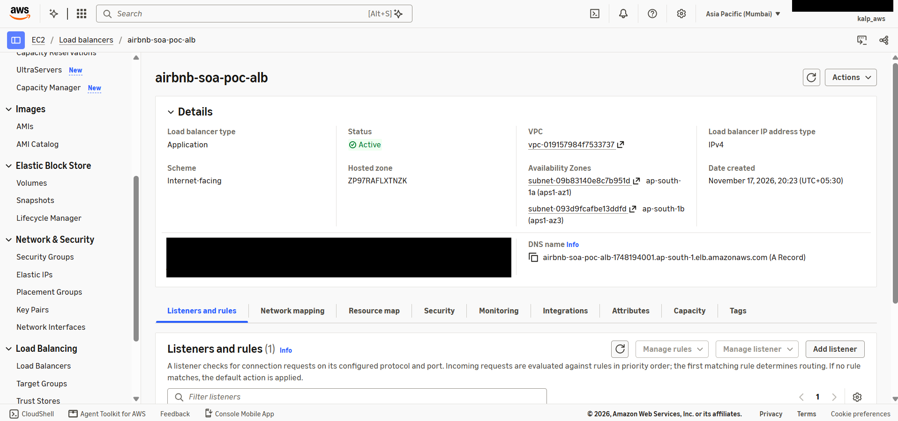

**What it shows:** EC2 → Load balancers → `airbnb-soa-poc-alb`: type **Application**, scheme **Internet-facing**, status **Active**, spread over **two Availability Zones** (`ap-south-1a` and `ap-south-1b`), with its public DNS name and **one listener** ("Listeners and rules (1)"). The load balancer ARN line is blacked out (it contained the account number).

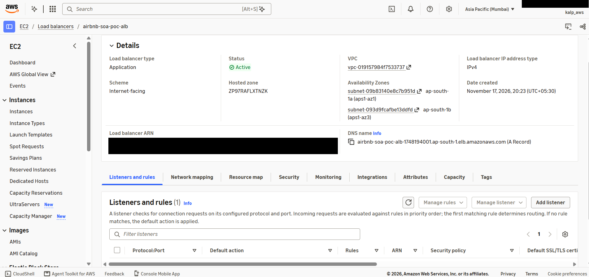

**What it shows:** the same load balancer scrolled to the listener table (Protocol:Port, default action, rules). The listener on port 80 forwards `/search*` to the search target group.

### 9.3 The target group and its health checks

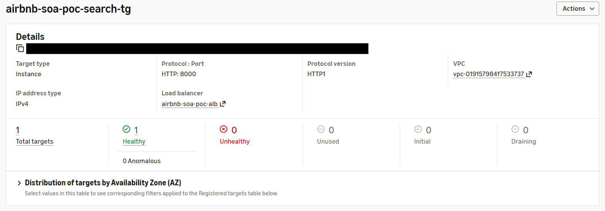

**What it shows:** target group `airbnb-soa-poc-search-tg`: protocol **HTTP on port 8000**, target type **Instance**, attached to `airbnb-soa-poc-alb`, with **1 healthy** and **0 unhealthy** targets. **Why it matters:** the load balancer only sends traffic to targets that pass the `/health` check. This screenshot was taken after scale-in, when one instance remained.

### 9.4 Automatic scale-out (E2): the main proof


**What it shows:** the Auto Scaling group list (`airbnb-soa-poc-search-asg` with **3 instances, 3/3 healthy**; the monolith and listing groups at 0) and the **Activity history**:
- **17:13:03Z**: alarm `TargetTracking-airbnb-soa-poc-search-asg-AlarmHigh-...` in state ALARM triggered policy `airbnb-soa-poc-search-cpu-target-50`, "changing the desired capacity from **2 to 3**"; an instance was started at 17:13:13Z (`i-075d11a3d5b2685fe`).
- **17:10:03Z**: the same alarm changed the desired capacity from **1 to 2**; an instance was started at 17:10:14Z (`i-071d4d07e38fefda6`).
- **17:01:49Z**: `AlarmLow` triggered the same policy and removed an instance (**2 to 1**), a scale-in left over from E1.

**Why it matters:** each launch states its **cause**: the CPU alarm fired and the scaling policy raised the desired capacity. Nobody launched these instances by hand. This is the evidence for "instances launching automatically when CPU is above 50%".

### 9.5 Automatic replacement and scale-out during E1


**What it shows (16:43–16:44Z, during the E1 overload test):**
- **16:43:57Z**: "Terminating EC2 instance `i-0e467d94...`": the instance "was taken out of service in response to an **ELB system health check failure**".
- **16:43:57Z**: a **replacement** instance was launched "in response to an unhealthy instance needing to be replaced".
- **16:44:03Z**: `AlarmHigh` fired and raised the desired capacity **1 to 2** (instance started at 16:44:08Z).

**Why it matters:** when one instance was driven far past its capacity it stopped answering health checks. The load balancer detected it, and Auto Scaling replaced it and added capacity automatically. It is documented honestly as a failure plus recovery (Section 6).

### 9.6 The scaling policy (the 50% CPU rule)

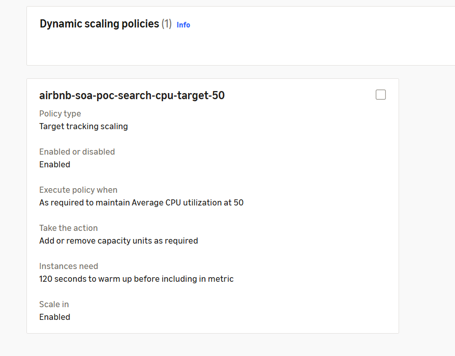

**What it shows:** dynamic scaling policy `airbnb-soa-poc-search-cpu-target-50`: policy type **Target tracking scaling**, **Enabled**, "as required to maintain **Average CPU utilization at 50**", "add or remove capacity units as required", instances need **120 seconds to warm up** before being included in the metric, and **scale-in enabled**. **Why it matters:** this is the "if CPU goes above 50%, add an instance" requirement from the brief, in the console.

### 9.7 The Auto Scaling group's own metrics

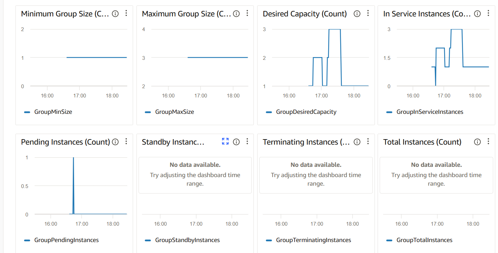

**What it shows:** the group's capacity charts over about three hours: **minimum 1**, **maximum 3**, **desired capacity** rising to 2 and 3 and then falling back to 1 (twice: the E1 and E2 episodes), **in-service instances** following it, and a short spike in pending instances at launch. **Why it matters:** an independent CloudWatch view of the same scale-out and scale-in recorded by my own 15-second sampler.

### 9.8 CPU utilization

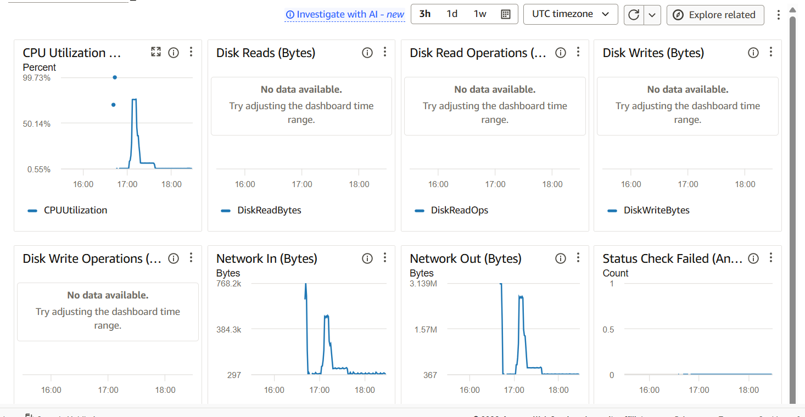

**What it shows:** the CPU Utilization panel for the group's instances: it rises sharply during the test periods (to roughly 70–76% in the one-minute averages) and drops back to near zero afterwards, together with network in/out peaks at the same times. **Why it matters:** the CPU crossed the **50% target** and fell back, which is what triggered the alarms above. The exact figures, with the 50% line, are in the graph `e2_cpu_over_time.png` (Section 7).

### 9.9 CloudWatch alarms created by the scaling policy

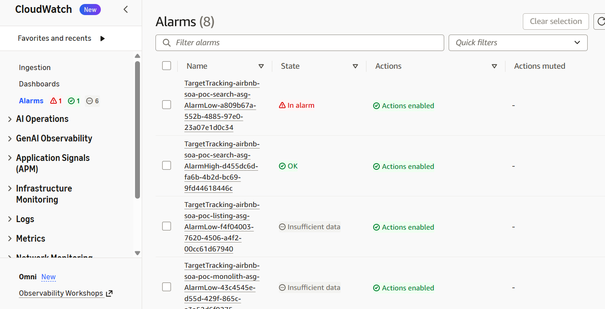

**What it shows:** CloudWatch → Alarms (8). Target tracking creates a **pair of alarms per Auto Scaling group**: `AlarmHigh` (add capacity) and `AlarmLow` (remove capacity). For the search group, `AlarmHigh` is **OK** (CPU below target) and `AlarmLow` is **In alarm** (CPU low, so extra capacity is not needed), which is the expected state after scale-in. The listing and monolith groups show **Insufficient data** because they run **zero instances**. **Why it matters:** it shows that AWS itself created and manages the CloudWatch alarms that drive scaling; I did not write them.

### 9.10 Response time against number of instances (the report's key graph)


Generated from the recorded k6 data and the instance counts (Section 7). The same figure is also in the author's submission document.

### 9.11 Docker autoscaling: containers behind Nginx


**What it shows:** `watch docker compose -p airbnb-autoscale ... ps` (WSL clock, Tue 17 Nov 20:27:29): the **gateway** (Nginx, `0.0.0.0:18081->80`), **postgres** (healthy), `search-1` (up 10 minutes) and **`search-2` (up 6 minutes)**. **Why it matters:** the autoscaler script started a second `search` container about four minutes after the first, which is the scale-out of the Docker companion (Section 8), with Nginx as the load balancer in front. The matching graph is `docker_p8_response_time_vs_containers.png`.


### 9.12 Screenshots still worth adding (optional)

The set above covers every requirement. If time allows, also capture: the k6 end-of-run summary (`results/raw/e2_k6_stdout.txt`), the autoscaler terminal showing `scale_out` and `scale_in` lines, and `docker stats` at the peak of a Docker run.

---

## 10. Limitations

- Only the **Search** service was deployed (8-vCPU quota); Listing and Booking were **not** tested through the ALB (Section 3).
- Traffic came from one home connection over the internet, so absolute latencies include network delay and the load generator could itself be a bottleneck at much higher rates.
- One run of each experiment (E1, E2) on one day; there are no repeated runs, so no confidence intervals. The 3-instance result rests on a single 30-second window.
- E1 was run to failure on purpose; it is a capacity probe, not a clean steady-state measurement.
- HTTP only (no TLS), single region, single-AZ database without backups. This is a PoC, not a production design.
- The peak load (16 req/s) is small in absolute terms; the demonstration is about the **shape** of the response (capacity added after CPU crossed the target, removed after load fell), not about large-scale throughput.
- Redis caching and asynchronous (SQS) booking were not exercised.
- The Docker companion (Section 8) uses a custom autoscaler script, not a Docker feature; it shows little latency change and flapped in run 1. Kubernetes autoscaling was not implemented.
- I did not verify alarm-history details beyond the ASG activity records (Observation 2).

---

## 11. Cost

**ESTIMATES** (ap-south-1, on-demand list prices from memory, not measured; check the Billing console for actuals):

| Item | Approximate |
|---|---|
| ALB | $0.03 / hour |
| RDS `db.t3.micro` + 20 GB storage | $0.02 / hour |
| `t3.micro` instances (1 to 3) | $0.012 each / hour |
| Public IPv4 addresses (instances + ALB) | $0.005 each / hour |
| **Whole stack, running** | **about $0.10 – 0.16 / hour** |

According to the console, the load balancer was created at 20:23 local time (UTC+05:30), i.e. **14:53 UTC** on 17 Nov, in the first `terraform apply`; the RDS database was created in the same apply, and the first instance launched at about 16:35 UTC. The stack was destroyed at 20:47 UTC, so it existed for about **5.9 hours** (about 1.7 hours of load balancer and database only, then about 4.2 hours with instances). Its cost is **estimated** at roughly $0.5 – 0.8 (the Billing console shows the actual figure). Leaving it running for a month would have cost roughly $90–110 (about the whole $100 credit), which is why it was destroyed once the evidence was saved. No NAT gateway, Redis or load-generator instance was created. A separate demo `t3.small` (about $19/month) exists outside this stack.

---

## 12. Reproduction

See the repository `README.md` ("AWS autoscaling assignment: reproduce") for exact commands. In brief: configure an IAM user, copy `terraform.tfvars.assignment.example` to `terraform.tfvars`, apply only the ECR repositories, run `scripts/build-push.sh`, apply the rest, run k6 (`fixed-capacity.js`, `search-spike.js`) with `scripts/monitor-asg.sh` alongside, then `analysis/bucket_k6.py` and `analysis/report_plots.py`. For the Docker companion see `reports/DOCKER_AUTOSCALING_GUIDE.md` (`docker/compose.autoscale.yaml`, `scripts/docker-autoscaler.sh`, `analysis/docker_plots.py`).

## 13. Cleanup

**Status (MEASURED): the assignment stack was destroyed** on 17 Nov 2026, `terraform destroy` from 20:37:33 to 20:47:31 UTC: **52 resources destroyed**, Terraform state empty. After the destroy, a read-only check of region ap-south-1 found **no** load balancers, target groups, Auto Scaling groups, RDS or ElastiCache instances, ECR repositories, SQS queues, non-default VPCs, NAT gateways, Elastic IPs or `airbnb-soa-poc` IAM roles. The live ALB URL in Section 4 therefore **no longer works**.

The separate demo EC2 (`i-0c09ab8dcb8b5a32f`, a `t3.small`) was **not** part of this stack and was not touched by the destroy. At the time of the check it was in the **stopped** state (stopped by a user action at 19:17 UTC on 17 Nov, not by this project's automation); its disk is preserved and it can be started from the EC2 console.

To rebuild the stack (for example for a demonstration), follow the README reproduction steps. To remove it again:

```bash
cd infra/terraform
terraform destroy -var-file=terraform.tfvars   # review the list; type yes
```

Remaining manual step for the account owner: detach the temporary extra IAM permissions from the IAM user `airbnb_project` when no further rebuilds are planned, and deactivate any root-account access keys.

## 14. Raw data and where it is

| Data | Location | In Git? |
|---|---|---|
| k6 per-request data (E1 26 MB, E2 56 MB) | `results/raw/e1_requests.csv`, `e2_requests.csv` | **No (back up manually)** |
| k6 per-request data, Docker runs | `results/raw/docker_p5_requests.csv`, `docker_p8_requests.csv` (large) | **No (back up manually)** |
| k6 console logs | `results/raw/e1_k6_stdout.txt`, `e2_k6_stdout.txt`, `docker_p5_k6_stdout.txt`, `docker_p8_k6_stdout.txt` | No |
| Docker summaries, buckets and autoscaler samples | `results/evidence/docker_p5_*`, `docker_p8_*` | Yes |
| k6 summaries, 30 s buckets, ASG samples, CloudWatch JSON, ASG activity history, run log | `results/evidence/` (account ID redacted) | Yes |
| Graphs | `reports/figures/` | Yes |

---

## Appendix A. How it all fits together, in plain language

1. **The application.** A search service (written in Python with FastAPI) answers requests like "show me listings in Goa". Each search deliberately does about 80 milliseconds of CPU work, so that a busy server really does get busy. The data (50,000 listings and the bookings) lives in a PostgreSQL database.
2. **Docker.** The service and everything it needs is packed into a **Docker image**, so it runs identically on my laptop and on an AWS server. The image is stored in **ECR**, Amazon's private image store.
3. **The servers.** On AWS, each server is an **EC2 instance** (a small virtual machine). A **launch template** is the recipe for one: which machine type, which security rules, and a start-up script that installs Docker, downloads the image from ECR and runs it. Because the recipe is automatic, a new server starts the application **without anyone logging in**.
4. **The load balancer.** Users never talk to a server directly. They talk to the **Application Load Balancer**, which hands each request to one of the **healthy** servers. It checks `/health` on every server every 20 seconds; a server that stops answering is taken out of rotation.
5. **The Auto Scaling Group.** This keeps between 1 and 3 servers running. A **target-tracking policy** says: "keep the average CPU at about 50%". AWS creates two CloudWatch alarms for that: one that fires when CPU stays high (add a server) and one when it stays low (remove one). So scaling is a rule, not a person.
6. **The shared database.** All servers use the **same RDS database**. If each server had its own database, a booking made on one server would be invisible on the others.
7. **Terraform.** Everything above is written as code, so the whole environment can be created with one command and removed with another. That is why it was safe to destroy it after collecting the evidence.
8. **k6 (the test).** A load-testing tool that sends a chosen number of requests per second. In E2 it sent 4 per second, rose to 16 per second (just above what one server can handle, about 15), held that for 10 minutes, then dropped back to 4.
9. **What happened.** With one server, CPU went to about 76% and response times grew past one second. CPU stayed above 50%, so the alarm fired and the Auto Scaling Group started a second server (17:10) and then a third (17:13). Response times fell back to around 200 milliseconds. When the traffic dropped, CPU fell, the low alarm fired about 19 minutes later, and the extra servers were removed (17:36 and 17:37). The screenshots in Section 9 show each of these steps in the AWS console.
10. **The Docker companion.** The same idea on my laptop: Nginx plays the load balancer, and because Docker has no autoscaler of its own, a small script I wrote watches CPU and starts or stops containers. It reproduces the behaviour, but it is a teaching model, not a replacement for AWS.

## Appendix B. Glossary

| Term | Meaning |
|---|---|
| **Auto Scaling Group (ASG)** | AWS service that keeps a chosen range of identical servers running and adds or removes them by rule |
| **Target tracking policy** | A scaling rule of the form "keep this metric (here CPU) near this value (50%)" |
| **ALB (Application Load Balancer)** | AWS service that spreads web requests across servers and health-checks them |
| **Target group** | The list of servers behind a load balancer, with the health-check settings |
| **EC2 / instance** | A virtual server; `t3.micro` has 2 vCPUs and 1 GB of memory |
| **Launch template** | The saved recipe an ASG uses to create each server |
| **ECR** | Amazon's private storage for Docker images |
| **RDS** | Amazon's managed database service (here PostgreSQL) |
| **CloudWatch** | AWS monitoring: metrics (CPU etc.) and alarms |
| **Warm-up** | Time (120 s) a new server is ignored when averaging CPU, so it is not counted before it can serve |
| **p50 / p95** | Median response time / the time that 95% of requests beat; p95 reveals the slow tail that averages hide |
| **k6, virtual user, arrival rate** | Load-testing tool; a simulated user; a fixed number of new requests per second regardless of how slow the server is |
| **Docker / container / image** | Packaging that runs an app the same everywhere; a running copy; the saved package |
| **Nginx** | Web server used here as a reverse proxy and load balancer in the Docker setup |
| **Terraform** | Tool that creates cloud resources from code (`plan`, `apply`, `destroy`) |
| **IMDSv2** | The more secure way for software on an instance to read its own metadata; required in the launch template |
| **vCPU quota** | The AWS limit on how many virtual CPUs the account may run (8 here) |

## Appendix C. What was done, in order (project log)

All times UTC on 17 Nov 2026 unless stated; the log is reconstructed from the saved run log, the Auto Scaling history and the console.

| Step | What | Outcome |
|---|---|---|
| 1 | Reconciled the two copies of the repository; fixed deployment settings (2 worker processes, `t3.micro`, IMDSv2) | One canonical branch, `aws-deploy-fixes` |
| 2 | Validated the Terraform; wrote a cost plan; chose to share one RDS database and drop Redis | Validated; about $0.10 – 0.16 per hour estimated |
| 3 | Found the account's EC2 quota is 8 vCPU (2 used by the demo) | Only Search deployed; Listing and Booking left at 0 |
| 4 | Built and pushed the 4 images to ECR (about 14:47 – 14:52) | Images verified in ECR |
| 5 | First full `terraform apply` (about 14:53) | Network, ALB and RDS created; stopped at a missing IAM permission (`iam:CreateRole`) |
| 6 | Permission added by the account owner; apply re-run | Stopped once more on a short Auto Scaling service-linked-role delay; third run completed |
| 7 | First search instance launched (about 16:35) and passed health checks | Live URL answered `/search` |
| 8 | **E1** (16:39 – 16:45): ramp 5 to 30 req/s on one instance | Capacity about 15 req/s; overload, health-check failure, automatic replacement and scale-out |
| 9 | **E2** (17:02 – 17:37): 4 to 16 req/s spike | Scale-out at 17:10 and 17:13; scale-in at 17:36 and 17:37 |
| 10 | Collected CloudWatch metrics and the Auto Scaling activity history | Saved in `results/evidence/` |
| 11 | **Docker companion** (18:59 – 19:30): two runs at 5 and 8 req/s | Containers scaled by CPU; flapping in run 1 |
| 12 | Report, graphs, viva guides written; screenshots taken by the author | This document |
| 13 | **Destroyed the stack** (20:37 – 20:47): 52 resources | Verified: no billable resources remain; demo EC2 untouched (stopped) |
