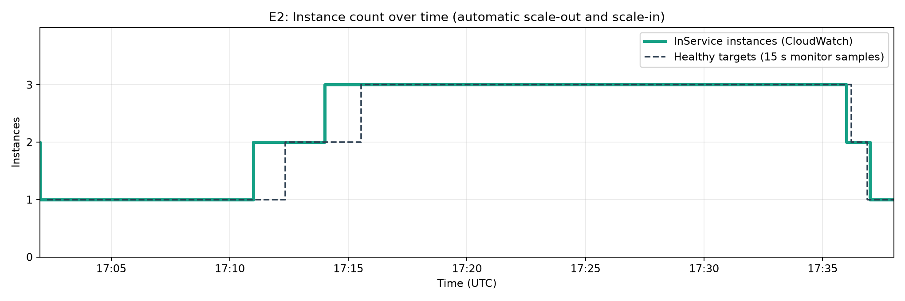
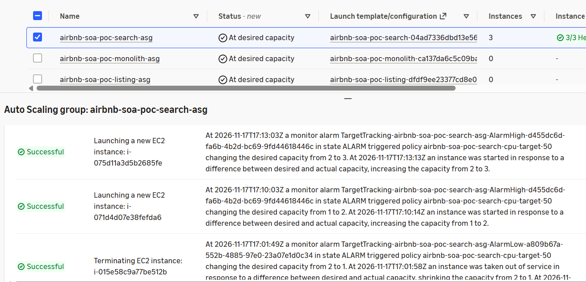
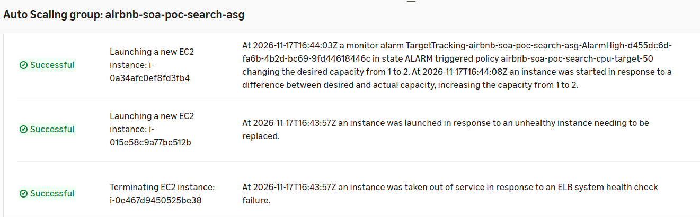
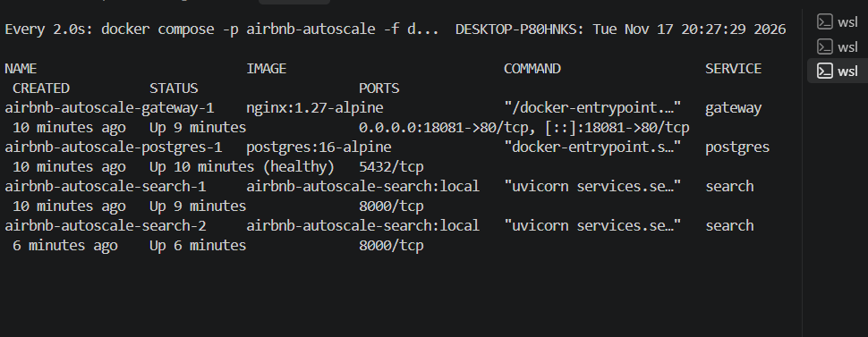

# Making an Airbnb-style app scale automatically on AWS

**Cloud Computing project · Theme 1: Scalability & High-Traffic Events (think Hotstar, IRCTC, Flipkart)**
Region: Mumbai (ap-south-1) · Tests run on 17 November 2026 · All times are UTC

---

## The short version

When a big event hits, traffic can jump ten times in minutes. If you run a fixed number of servers, you either crash during the spike or pay for idle machines the rest of the year. The fix is to let the cloud add servers when they're busy and remove them when they're not.

I took a small Airbnb-style application, packed it into Docker containers, and ran it on AWS behind a load balancer with an Auto Scaling Group that is told to *keep average CPU at 50%*. Then I hit it with a load test:

- **One server** could handle about **15 requests per second**.
- When I sent **16 per second** for ten minutes, CPU on that single server shot up to about **76%** and response times climbed past one second.
- Auto Scaling noticed, and without any help from me **launched a second server and then a third**. Response times dropped back to about a fifth of a second.
- When I stopped the traffic, it **removed the extra servers on its own**.

The numbers, graphs and AWS console screenshots below back up each of those statements. I also rebuilt the same idea on my laptop with Docker and Nginx as a smaller companion experiment (Section 8). Where something didn't go perfectly, I've said so (Section 10).

**What the brief asked for, and where to find it**

| Required | Done? | Where |
|---|---|---|
| A live URL served through a load balancer | Yes (the stack has since been shut down to stop the charges) | Sections 3 and 9.1 |
| Screenshots of the Auto Scaling Group launching instances | Yes | Section 9 |
| A load-test report: response time vs number of instances | Yes | Section 6 (the main graph) |
| Scale-out when CPU is over 50%, scale-in when traffic drops | Yes, both observed | Sections 6 and 9 |
| Bonus: the same idea with Docker + Nginx | Yes (Kubernetes was not done) | Section 8 |

---

## 1. What the application is, and where everything lives

It's a deliberately small, simplified "Airbnb". It exists to give the load tests something realistic to chew on, not to be a finished product.

### Where the code is
Everything is in the `services/` folder of the repository (https://github.com/kalpshah546/AirBnB_Cloud_Project, branch `aws-deploy-fixes`). It's written in Python using the FastAPI web framework.

| File / folder | What it does |
|---|---|
| `services/search/app.py` | **Search**: `GET /search?city=Goa&max_price=8000&limit=20` returns matching listings, best-rated first |
| `services/listing/app.py` | **Listing detail**: `GET /listings/1` returns one listing (looks in the Redis cache first, then the database) |
| `services/booking/app.py` | **Booking**: `POST /bookings` records a booking. The `Idempotency-Key` header makes sure that if a request is retried, the guest isn't booked twice |
| `services/booking/worker.py` | Optional background worker that confirms bookings from a queue (SQS) |
| `services/monolith/app.py` | All three of the above in one process, only used for a separate comparison experiment |
| `services/common/` | Shared code: database connection and tables (`db.py`), fake data generator (`data.py`), cache (`cache.py`), health check (`health.py`), settings (`config.py`) |
| `services/*/Dockerfile` | One Docker recipe per service |
| `compose.yaml` | Runs the whole thing locally with Docker Compose |
| `infra/terraform/` | The AWS infrastructure as code |
| `loadtest/k6/` | The load-test scripts |

Every service also has `GET /health`, which simply answers `{"status":"ok"}`. The load balancer uses it to decide whether a server is alive.

### Where the database is
The database is **PostgreSQL**. There is no SQL file or dump in the repository: the program **creates its own tables when it starts** (see `ensure_schema()` in `services/common/db.py`):

- `listings`: id, city, title, nightly price, rating, bedrooms
- `bookings`: id, idempotency key, listing, guest, check-in, check-out, guests, status

The data itself is **fake and generated by code**. `services/common/data.py` makes 50,000 listings across 14 Indian cities (Mumbai, Goa, Delhi, Bengaluru, Pune and so on), with prices from ₹900 to ₹12,000 and ratings from 3.0 to 5.0. It uses a seeded random generator, so the same listing number always produces the same listing, which keeps tests repeatable. Nothing real is stored.

Where that database physically ran:

| Where | What |
|---|---|
| On my laptop | A `postgres` container in `compose.yaml` |
| The separate demo server (EC2 `i-0c09ab8dcb8b5a32f`) | A `postgres` container in `compose.prod.yaml` (the server is currently stopped; its disk is intact) |
| The AWS test stack | An RDS PostgreSQL database, created by Terraform and **deleted** afterwards |

### What the application actually does
1. **Search** takes the 50,000 listings, filters them by city, price and rating, sorts them and returns the top few. To make the service genuinely CPU-hungry (so that scaling has something to react to) each search also **deliberately burns about 80 ms of CPU** doing pointless arithmetic. That setting is `SEARCH_CPU_WORK_MS=80`.
2. **Listing** fetches one listing by id, trying Redis first and falling back to PostgreSQL.
3. **Booking** inserts a row into `bookings`. In "direct" mode it is confirmed at once; in "async" mode it is queued and a worker confirms it later.

> **Something I only confirmed late in the project, and want to be upfront about:** the **Search service does not use the database at all.** It builds its 50,000 listings in memory when it starts, and its health check doesn't touch a database either. Only Listing and Booking read and write PostgreSQL. Because the whole AWS test used only Search (Section 2 explains why), the RDS database I created **was running but idle** the entire time. It didn't affect the results, but it cost a little money for nothing. For the full application the shared database *does* matter: if every server had its own private database, a booking made on one server would be invisible on the others.

---

## 2. How I set it up on AWS

```
                           Internet
                              |
                   +----------v-----------+
                   |  Application Load    |  port 80, spread over 2 data centres
                   |  Balancer (ALB)      |  /search* goes to the search target group
                   +----------+-----------+
                              |
                   +----------v-----------+
                   |  Target group        |  checks GET /health every 20 s
                   +----------+-----------+  3 misses = server removed from rotation
                              |
        +---------------------v----------------------+
        |  Auto Scaling Group (search)               |  minimum 1, maximum 3 servers
        |  t3.micro servers running the Docker image |  rule: keep average CPU at 50%
        +---------------------+----------------------+
                              .
                              .  (RDS PostgreSQL was created, but the Search
                              .   service never used it, see Section 1)
```

In plain words:

- **Users talk to the load balancer**, never to a server. The load balancer hands each request to a server that is passing its health check.
- **Each server is an EC2 `t3.micro`** (2 virtual CPUs, 1 GB). The Auto Scaling Group builds them from a *launch template*, a saved recipe that says "install Docker, download my image from ECR (AWS's private image store), run it". That's why a brand-new server starts working without anyone logging in.
- **The Auto Scaling Group keeps between 1 and 3 servers.** A *target-tracking policy* says "keep average CPU near 50%". AWS creates two CloudWatch alarms from that: one fires when CPU stays above target (add a server), the other when it stays well below (remove one).
- **Everything is Terraform code** in `infra/terraform/`, so the whole thing can be built with one command and torn down with another.

### The important settings

| Setting | Value | Why |
|---|---|---|
| Server type | `t3.micro` | `t2` slows itself down when its CPU "credits" run out, which would ruin a load test |
| Worker processes per server | 2 | Python uses one CPU core per process. With only 1 worker, a 2-CPU server could never go above ~50% CPU, so scaling would never trigger |
| Scaling rule | Target tracking, average CPU **50%** | The requirement from the brief |
| Group size | min 1, desired 1, max 3 | Fits the account's CPU quota (below) |
| Warm-up | 120 s | A new server isn't counted in the average until it has had time to start serving |
| Security | Servers only accept traffic from the load balancer; no SSH; metadata service v2 required | Least privilege |

### Why only the Search service was deployed
The Search service is the CPU-hungry one, so it's the one that shows CPU-based scaling. And there was a hard limit: the AWS account may run only **8 virtual CPUs** at once. My separate demo server already used 2, leaving 6, which is just **three** `t3.micro` servers. Running Search up to three servers used the whole allowance, so the Listing and Booking groups were set to **zero servers**. I did not ask for a quota increase.

Be clear on the consequence: **Listing and Booking were not running behind the load balancer and were not tested there** (`/listings/...` simply returned "503 service unavailable"). I did test health, search, listing and booking earlier on the separate single-server demo, but that isn't part of this experiment.

---

## 3. The live URL

```
http://airbnb-soa-poc-alb-1748194001.ap-south-1.elb.amazonaws.com/search?city=Goa&limit=5
```

It returned a normal 200 response with real search results from the 50,000-listing dataset (screenshot in Section 9.1). **That link no longer works**: I shut the whole stack down once the evidence was saved, because leaving it up for a month would have eaten most of the $100 credit (Section 11). The Terraform code rebuilds it in about half an hour (Section 12).

---

## 4. How the load was generated

I used **k6**, a load-testing tool. You write a small JavaScript file saying what one request looks like, and k6 sends it over and over.

The key choice is *how* k6 decides how much traffic to send. There are two styles:

- **A fixed number of users** who each wait for a reply before sending the next request. If the server slows down, those users slow down too, which quietly hides the overload.
- **A fixed number of requests per second**, no matter what. If the server falls behind, requests pile up and response times grow, which is what a real crowd does on sale day. **This is what I used** (k6's `ramping-arrival-rate`).

The test requests were `GET /search?city=Goa&max_price=8000&min_rating=3.5&limit=20`, sent from my own laptop over the internet. So the response times include the trip across the internet (about 130 ms even when the server is idle), and they would be lower if the load generator sat inside AWS.

How to turn "requests per second" into "people": the server only feels the request rate. If a typical person clicks roughly once every 10 seconds, then **16 requests per second is about 160 people** using the site at the same time. That conversion is an assumption of mine, not a measurement.

For every run I saved each individual request (`results/raw/*.csv`), the k6 summary, CloudWatch metrics, the Auto Scaling activity log, and my own 15-second snapshots of how many servers were healthy. The latency graphs use 30-second windows of that data.

---

## 5. Test 1: how much can one server take?

I ramped one server from 5 up to 30 requests per second.


| Requests per second | Median response | 95% of requests faster than | Errors |
|---|---|---|---|
| about 2 to 7 | 126 – 128 ms | 163 – 203 ms | none |
| about 10 | 130 ms | 160 ms | none |
| about 15 | 145 ms | 200 ms | none |
| about 19 | 273 ms | 1,015 ms | none |
| about 19, 30 seconds later | 3.3 s | 5.5 s | none |
| about 19, two minutes later | 18 s | 40 s | 0.7% |

**One `t3.micro` comfortably handles about 15 requests per second.** Push it past roughly 17 to 19 and the queue grows faster than the server can clear it, and response times collapse.

### And then it broke, which turned out to be useful
I deliberately pushed past that limit, and the server stopped answering the load balancer's health check. The Auto Scaling log shows what happened next (screenshot in Section 9.5):

| Time | What happened |
|---|---|
| 16:43:57 | The load balancer's health check failed, so Auto Scaling **took the unhealthy server out of service** |
| 16:43:57 | It **launched a replacement** straight away |
| 16:44:03 | The CPU alarm fired and raised the target from 1 to 2 servers |
| 16:44:08 | An **additional server** started (on top of the replacement) |

Over the whole test, 7,231 requests were sent and **31.8% failed**, with a worst-case 95th percentile of 24.5 seconds. That's bad on purpose: it was a capacity probe, not a clean measurement. For that reason I did not use E1 for the main graph. It's still a genuine example of AWS detecting a failure and recovering by itself.

---

## 6. Test 2: a traffic spike (the main result)

Starting from **one server**, I sent 4 requests per second for 2 minutes, ramped up to **16 per second** (just above one server's limit), held that for 10 minutes, then dropped back to 4 for about 20 minutes so I could watch it scale back down. Start: 17:02. End: 17:37.

### The graph the brief asks for: response time against number of servers


How to read it: the **green line** is how many healthy servers were behind the load balancer (right-hand scale). The **red line** is the response time that 95% of requests beat, and the **blue line** is the median (left-hand scale, in milliseconds). The dotted vertical lines are the moments Auto Scaling added or removed a server.

What it shows, in order:

1. With **one** server and the load climbing, response times drift upward and reach about 1.3 seconds.
2. At 17:10 a second server is added; once it passes its health check (about 17:12) response times **fall straight back to about 270 ms**.
3. A third server joins at 17:13.
4. After the traffic stops, the extra servers are removed at 17:36 and 17:37, back to one.

### The same thing in numbers (peak load, about 16 requests per second)

| Healthy servers | 30-second windows | Median response | Typical slow response (p95) | Worst p95 |
|---|---|---|---|---|
| 1 | 12 | 366 ms | **680 ms** | 1,308 ms |
| 2 | 6 | 145 ms | **257 ms** | 277 ms |
| 3 | 1 | 145 ms | **203 ms** | 203 ms |

A fair warning: only one 30-second window had three servers, because the third one became healthy near the end of the peak. The difference between one and two servers rests on 12 and 6 windows, which is a decent sample. The difference with three is only suggestive.


### What happened, minute by minute

| Time | Event |
|---|---|
| 17:02 | Test starts with 1 server |
| 17:04 – 17:06 | Traffic ramps from 4 to 16 per second |
| about 17:07 | CPU goes above 50% (it settles around 76%) |
| 17:10:03 | The CPU alarm goes off, and Auto Scaling asks for 2 servers |
| **17:10:14** | **Server #2 starts** |
| 17:12 | Server #2 is healthy and starts taking traffic; response times drop |
| 17:13:03 | The alarm goes off again, and Auto Scaling asks for 3 servers |
| **17:13:13** | **Server #3 starts** |
| 17:16 | Traffic drops back to 4 per second |
| **17:35:59** | **Auto Scaling removes a server** (3 to 2) |
| **17:37:00** | **It removes another** (2 to 1) |




Overall for the run: **16,679 requests, 2 failed (0.01%)**, median 160 ms, 95th percentile 623 ms, slowest request 7 seconds.

### Things I noticed (including ones I can't fully explain)
- **It isn't instant.** CPU crossed 50% at about 17:07 but the new server only started helping around 17:12, about five minutes later. AWS waits for several consecutive high readings, then the server has to boot, download the image and pass two health checks. During that gap, users got the slower responses.
- **A third server launched even though average CPU had already dropped to about 45%.** The most likely reason is that the high-CPU alarm was still counting earlier readings. I did not check the alarm history to confirm that.
- **Scale-in is slow on purpose.** The servers went away about 19 minutes after the traffic dropped. AWS waits to be sure the quiet is real, so it doesn't add and remove servers in a loop.
- **One latency spike I can't explain**, at about 17:24:45 (95th percentile ≈ 1.1 s), with three healthy servers and almost no traffic. It's in the data and on the graph. It might be a blip on my internet connection, but I didn't investigate.

---

## 7. What the two tests say when you put them together

- **Test 1** told me where the limit is: about 15 requests per second per server, and what failure looks like when you go past it (slow, then unhealthy, then replaced).
- **Test 2** showed the cure in action: with the traffic just above that limit, Auto Scaling added capacity within a few minutes and the slow responses went away, then it quietly took the capacity back when the crowd left.
- The one honest weakness is **timing**. Scaling reacted in about five minutes, not five seconds. For a spike that arrives gradually that's fine; for a sudden "tickets go on sale at 10:00" moment you would want to **add servers before the event** (the Terraform in this project has a scheduled pre-warm mode for exactly that, which I did not test).

The screenshots that back all this up are in Section 9, after the Docker section.

---

## 8. The Docker version (companion experiment)

I wanted to see the same idea in a form I could run on my own laptop for free, so I built it with Docker and **Nginx as the load balancer** in place of the AWS load balancer.

There is an important catch that's worth saying out loud in a viva: **Docker has no autoscaler.** Docker (and Docker Compose) can start N copies of a container, but nothing in Docker decides what N should be. So I wrote a small script, `scripts/docker-autoscaler.sh`, that watches the containers' CPU every 10 seconds and starts or stops copies, using the same rule Kubernetes uses: `ceil(current × CPU ÷ 50)`, between 1 and 5 containers. In the AWS setup, that "decide how many" job belongs to the Auto Scaling Group instead. I did not do the Kubernetes version.

How they compare:

| | AWS | Docker on my laptop |
|---|---|---|
| Load balancer | AWS Application Load Balancer | Nginx container |
| What gets scaled | EC2 servers (2 CPUs each) | Containers (limited to 0.6 CPU each) |
| Who decides | The Auto Scaling Group | My script |
| Removes broken servers | Yes (it did, in E1) | No |
| Cost | about $0.10 – 0.16 per hour | none |

Nginx finds new containers because Docker's internal DNS name `search` returns every running copy, and Nginx re-checks that name every 2 seconds (`docker/nginx.autoscale.conf`).

### Results (two runs, both from my laptop)

| Run | Peak | Containers over time | Requests | Failures | Median | 95th percentile |
|---|---|---|---|---|---|---|
| 1 | 5 requests/s | 1 → 2 → 3 → 2 → 3 → 1 | 2,249 | 0 | 101 ms | 126 ms |
| 2 | 8 requests/s | 1 → 2 → 3 → 4 → 1 | 3,284 | 0 | 101 ms | 154 ms |


Honest reading:
- **The scaling worked** and no request failed.
- **The speed-up is tiny**, because my laptop is fast: even one 0.6-CPU container handled 8 requests per second. The big, convincing slow-down-then-recover effect is in the AWS test, where a small server was genuinely overwhelmed.
- **Run 1 flapped** (3 → 2 → 3): with two containers the CPU would sit just above the 50% target, so removing one was the wrong call. A real Kubernetes autoscaler smooths that out; my 60-line script doesn't.
- **One slow request each time it scaled in** (3.2 s and 6.2 s). It fits Nginx briefly trying a container that had just been removed and waiting out a 3-second timeout once or twice. That's my best guess, not something I verified. The AWS load balancer avoids this by draining connections first.
- I couldn't prove an even spread of requests across containers by counting, because removed containers take their logs with them.

Full details, with the commands to run it yourself and an explanation of k6, are in `reports/DOCKER_AUTOSCALING_GUIDE.md`.

---

## 9. Screenshots from AWS and my terminal

These are my own screenshots from the day, shown as taken. Auto Scaling's activity text is in UTC; the load balancer's "Date created" is shown in my local time (UTC+05:30), so 20:23 there is 14:53 UTC.

### 9.1 The live URL working through the load balancer


This is the browser showing the answer from `.../search?city=Goa`. It's JSON from the Search service: 50,000 listings in the dataset, 3,572 matches in Goa, and the first five results with their id, title, nightly price, rating and bedrooms. It came through the AWS load balancer from a server in the Auto Scaling Group.

### 9.2 The load balancer


The load balancer `airbnb-soa-poc-alb`: an **Application** load balancer, **internet-facing**, **Active**, spread across **two availability zones** (ap-south-1a and 1b), with its public DNS name and one listener.


The same page scrolled to the listener table. The listener on port 80 sends `/search` requests to the search target group.

### 9.3 The target group (the list of servers behind it)


`airbnb-soa-poc-search-tg`: HTTP on port 8000, **1 healthy and 0 unhealthy** target. The load balancer only sends traffic to servers passing the health check. (This was captured after scale-in, when one server was left.)

### 9.4 Servers launching automatically (the key screenshot)



The Auto Scaling group `airbnb-soa-poc-search-asg` showing **3 servers, 3/3 healthy**, and its activity log. Reading it from the bottom up:

- **17:01:49** the "AlarmLow" alarm removed a server (2 → 1), a leftover from the first test.
- **17:10:03** the "AlarmHigh" alarm went off and the policy `airbnb-soa-poc-search-cpu-target-50` changed the wanted capacity **from 1 to 2**; the new server started at 17:10:14.
- **17:13:03** the same alarm changed it **from 2 to 3**; that server started at 17:13:13.

Each row states its cause, an alarm triggering the scaling policy. Nobody launched these by hand.

### 9.5 When one server was overloaded in Test 1



- **16:43:57** one server was "taken out of service in response to an **ELB system health check failure**".
- **16:43:57** a replacement was launched "in response to an unhealthy instance needing to be replaced".
- **16:44:03** the CPU alarm went off and capacity went from 1 to 2.

### 9.6 The 50% rule


The scaling policy `airbnb-soa-poc-search-cpu-target-50`: **Target tracking**, enabled, "maintain **Average CPU utilization at 50**", new servers get **120 seconds to warm up**, scale-in enabled. This is the "add a server when CPU is over 50%" rule from the brief.

### 9.7 The group's own charts


Capacity charts from CloudWatch over about three hours: minimum 1, maximum 3, the **desired capacity** rising to 2 and 3 and falling back to 1 (twice, once for each test), and the **in-service instances** following it. It's an independent confirmation of what my own 15-second sampler recorded.

### 9.8 CPU


CPU for the group's servers, rising during the tests and dropping back to nearly nothing afterwards, with network traffic peaking at the same times. The exact figures with the 50% line are in the graph in Section 6.

### 9.9 The CloudWatch alarms Auto Scaling created


Target tracking creates a pair of alarms per group: **AlarmHigh** (add a server) and **AlarmLow** (remove one). For the search group, AlarmHigh is "OK" and AlarmLow is "In alarm", which is exactly right after scale-in: CPU is low, so no extra capacity is wanted. The listing and monolith groups say "Insufficient data" because they run zero servers. I didn't write these alarms: AWS created and manages them.

### 9.10 The Docker version



`docker compose ps` while the Docker demo was running: the **Nginx gateway** on port 18081, **postgres**, and two search containers, `search-1` (up 10 minutes) and **`search-2` (up 6 minutes)**, the second one started by the autoscaler script about four minutes after the first.

---

## 10. What didn't go perfectly

I'd rather say these than have them found:

- **Only Search was tested on AWS** (CPU quota), and **Listing and Booking were never tested behind the load balancer.**
- **The database sat idle.** The Search service doesn't use it, so the RDS database I paid for wasn't part of what was measured (Section 1).
- **One run of each test.** No repeats, so no error bars, and the three-server result rests on a single 30-second window.
- **Test 1 was run to failure on purpose**, so it's a capacity probe, not a clean measurement.
- **The load came from my laptop over the internet**, so response times include the network, and my laptop could become a bottleneck at much higher rates.
- **The peak is small** (16 requests per second). The point is the *shape* of the response (capacity added after CPU crossed the target, removed after traffic fell), not big-scale throughput.
- **Plain HTTP only**, one region, a single-zone database with no backups. This is a proof of concept.
- **I didn't dig into every alarm detail** (the third-server question in Section 6).
- **The Docker autoscaler is my own simple script**, not a Docker feature; it flapped in run 1 and shows little speed-up. No Kubernetes.
- **Redis caching and queue-based bookings** weren't exercised.

---

## 11. Cost

Prices below are estimates from list prices (Mumbai, on-demand), not measured. The Billing console has the real figure.

| What | About |
|---|---|
| Load balancer | $0.03 / hour |
| RDS database (idle, as noted) | $0.02 / hour |
| Each `t3.micro` server | $0.012 / hour |
| Each public IPv4 address | $0.005 / hour |
| **Whole stack, running** | **roughly $0.10 – 0.16 / hour** |

The console shows the load balancer was created at **14:53 UTC** and I destroyed everything at **20:47 UTC**, about **5.9 hours**: roughly 1.7 hours with just the load balancer and database, then about 4.2 hours with servers. That puts the total at roughly **$0.50 – 0.80 (estimate)**. Left running for a month it would have been around $90 – 110, nearly the whole credit, which is why I shut it down. There was no NAT gateway, no Redis and no extra load-generator server. A separate demo server (`t3.small`, about $19/month if left on) exists outside this stack and is currently stopped.

---

## 12. Shutting down, and building it again

**Shut down (done):** `terraform destroy` ran from 20:37 to 20:47 UTC and removed all **52 resources**. A check of the Mumbai region afterwards found no load balancers, target groups, Auto Scaling groups, databases, caches, image repositories, queues, extra networks, NAT gateways, Elastic IPs or project IAM roles. The separate demo server was **not** part of the stack and wasn't touched; it is stopped, with its data intact. (Evidence: `results/evidence/destroy_verification.txt`.)

**Left for the account owner:** remove the temporary extra IAM permissions from the `airbnb_project` user, and turn off any root access keys.

**To build it again** (about 30 minutes, about $0.10 – 0.16 per hour while it's up), from WSL with the IAM user (not the root account) configured:

```bash
cp infra/terraform/terraform.tfvars.assignment.example infra/terraform/terraform.tfvars   # set create_budget = false
cd infra/terraform && terraform init
terraform apply -var-file=terraform.tfvars -target=aws_ecr_repository.images     # image repositories first
cd ../.. && ./scripts/build-push.sh                                              # build and upload the images
cd infra/terraform && terraform apply -var-file=terraform.tfvars                 # everything else, 10-15 min
terraform output alb_base_url                                                    # your new live URL
terraform destroy -var-file=terraform.tfvars                                     # when finished
```
If the second apply stops on a service-linked-role error, wait a minute and run the same command again. The README has the full steps, including the k6 commands.

---

## 13. Where everything is

| What | Where |
|---|---|
| Application code | `services/` |
| Infrastructure (Terraform) | `infra/terraform/` |
| Load-test scripts | `loadtest/k6/` |
| Docker autoscaling demo | `docker/`, `scripts/docker-autoscaler.sh` |
| Analysis and graph scripts | `analysis/` |
| Graphs | `reports/figures/` |
| Screenshots | `screenshots/` |
| Small, safe-to-share data (summaries, 30-second buckets, CloudWatch exports, Auto Scaling history, run log) | `results/evidence/` |
| **Large raw k6 files (not in Git; back these up)** | `results/raw/e1_requests.csv`, `e2_requests.csv`, `docker_p5_requests.csv`, `docker_p8_requests.csv`, plus the `*_k6_stdout.txt` logs |
| Viva notes | `docs/VIVA_WORKFLOW.md`, `docs/VIVA_GUIDE.md` |

---

## Appendix A. Glossary

| Term | In plain words |
|---|---|
| **Auto Scaling Group** | An AWS service that keeps a chosen range of identical servers running and adds or removes them by rule |
| **Target tracking** | A rule of the form "keep this number (here, CPU) near this value (50%)" |
| **Load balancer (ALB)** | Hands each incoming request to one of several servers and checks that they're alive |
| **Target group** | The list of servers behind a load balancer, plus the health-check settings |
| **EC2 instance** | A virtual server. A `t3.micro` has 2 virtual CPUs and 1 GB of memory |
| **Launch template** | The saved recipe an Auto Scaling Group uses to build each new server |
| **ECR** | AWS's private storage for Docker images |
| **RDS** | AWS's managed database service (here PostgreSQL) |
| **CloudWatch** | AWS monitoring: metrics such as CPU, and alarms |
| **Warm-up** | The time a new server is ignored in the CPU average, so it isn't counted before it can serve |
| **Median / p95** | The typical response time / the time that 95% of requests beat, which shows the slow tail that averages hide |
| **k6 / arrival rate** | The load-testing tool / a fixed number of new requests per second whatever the server does |
| **Docker, image, container** | A way of packaging an app so it runs the same everywhere; the saved package; a running copy of it |
| **Nginx** | A web server used here as a reverse proxy and load balancer in the Docker setup |
| **Terraform** | A tool that builds cloud resources from code (`plan`, `apply`, `destroy`) |
| **vCPU quota** | The AWS limit on how many virtual CPUs an account may run at once (8 here) |

## Appendix B. The project in order

| Step | What I did | Result |
|---|---|---|
| 1 | Merged the two copies of the repository and fixed the deployment settings (2 workers, `t3.micro`, IMDSv2) | One branch, `aws-deploy-fixes` |
| 2 | Checked the Terraform, wrote a cost plan | Valid; about $0.10 – 0.16 per hour |
| 3 | Found the 8-vCPU quota (2 used by the demo) | Deploy Search only |
| 4 | Built the four Docker images and pushed them to ECR (about 14:47 – 14:52) | Images stored in ECR |
| 5 | First full `terraform apply` (about 14:53) | Network, load balancer and database built; stopped on a missing IAM permission |
| 6 | Account owner added the permission; re-ran | One more short wait on an Auto Scaling role, then it completed |
| 7 | First search server launched (about 16:35) and became healthy | The live URL answered |
| 8 | **Test 1** (16:39 – 16:45) | One server handles ~15 requests/s; overload, health-check failure, automatic replacement |
| 9 | **Test 2** (17:02 – 17:37) | Scale-out at 17:10 and 17:13, scale-in at 17:36 and 17:37 |
| 10 | Saved the CloudWatch data and the Auto Scaling history | `results/evidence/` |
| 11 | **Docker version** (18:59 – 19:30) | Two runs, containers scaled by CPU |
| 12 | Took the screenshots; wrote the report and viva notes | This document |
| 13 | **Shut down the stack** (20:37 – 20:47) | 52 resources removed; checked that nothing billable remains |
