# Making an Airbnb-style app scale automatically on AWS

**Cloud Computing project · Theme 1: Scalability & High-Traffic Events (think Hotstar, IRCTC, Flipkart)**
Region: Mumbai (ap-south-1) · Tests run on 17 November 2026 · All times are UTC

---

## The idea in one minute

When a big event hits, traffic can jump ten times in minutes. If you run a fixed number of servers, you either crash during the spike or pay for idle machines the rest of the year. The fix is to let the cloud add servers when they are busy and take them away when they are not.

I took a small Airbnb-style application, packed it into Docker containers, and ran it on AWS behind a load balancer. An Auto Scaling Group watches the servers and is told one simple rule: **keep the average CPU at about 50%**. Then I hit the system with a load test and watched what it did:

- **One server** could handle about **15 requests per second**.
- When I sent **16 per second** for ten minutes, the CPU on that one server shot up to about **76%** and response times climbed past a second.
- Auto Scaling noticed, and without any help from me it **started a second server, then a third**. Response times dropped back to about a fifth of a second.
- When the traffic stopped, it **removed the extra servers by itself**.

The graphs and the AWS screenshots below show each of those steps. At the end I show the same idea built on my own laptop with Docker and Nginx.

---

## 1. The application

It is a small, simplified "Airbnb". Its job is to give the load tests something realistic to work on.

**Where the code is:** the `services/` folder of the repository (`github.com/kalpshah546/AirBnB_Cloud_Project`, branch `aws-deploy-fixes`), written in Python with FastAPI.

| Part | What it does |
|---|---|
| **Search** (`services/search/app.py`) | `GET /search?city=Goa&limit=20` returns matching listings, best-rated first. Each search also deliberately burns about 80 ms of CPU, so that a busy server really does get busy |
| **Listing** (`services/listing/app.py`) | `GET /listings/1` returns one listing (checks the Redis cache first, then the database) |
| **Booking** (`services/booking/app.py`) | `POST /bookings` records a booking. An `Idempotency-Key` header makes sure a retried request doesn't book the guest twice |
| **Health check** | Every service answers `GET /health` with `{"status":"ok"}`. The load balancer uses this to know a server is alive |

**Where the database is:** PostgreSQL. There is no SQL file: the program creates its own two tables, `listings` and `bookings`, when it starts (`services/common/db.py`). The data is **fake and generated by code**: `services/common/data.py` makes 50,000 listings across 14 Indian cities, always the same ones, so tests are repeatable.

One thing worth knowing: **the Search service doesn't use the database.** It builds its 50,000 listings in memory when it starts. Only Listing and Booking use PostgreSQL.

---

## 2. How I set it up on AWS

```
                           Internet
                              |
                   +----------v-----------+
                   |  Application Load    |   port 80, across 2 data centres
                   |  Balancer            |   sends /search to the search servers
                   +----------+-----------+
                              |
                   +----------v-----------+
                   |  Target group        |   checks GET /health every 20 seconds
                   +----------+-----------+   removes a server that stops answering
                              |
        +---------------------v----------------------+
        |  Auto Scaling Group                        |   1 to 3 servers
        |  t3.micro servers running my Docker image  |   rule: keep average CPU at 50%
        +--------------------------------------------+
```

In plain words:

- **People talk to the load balancer**, never to a server directly. It passes each request to a server that is passing its health check.
- **Each server is an EC2 `t3.micro`** (2 virtual CPUs, 1 GB). The Auto Scaling Group builds each one from a saved recipe (a *launch template*): install Docker, download my image from ECR (AWS's private image store), and run it. That is why a brand-new server starts working with nobody logging in.
- **The Auto Scaling Group keeps between 1 and 3 servers.** Its rule, called *target tracking*, says "keep average CPU near 50%". AWS turns that into two CloudWatch alarms: one goes off when CPU stays high (add a server) and one when it stays low (remove one).
- **Everything is written as Terraform code** (`infra/terraform/`), so the whole setup can be created, and removed, with one command each.

Two choices worth explaining:

- **`t3` servers, not `t2`:** a `t2` slows itself down when its CPU "credits" run out, which would have ruined the test.
- **Two worker processes per server:** Python uses one CPU core per process. With one worker, a 2-CPU server could never go much above 50% CPU, so the scaling rule would never fire.

**Why only the Search service was deployed:** Search is the CPU-hungry one, so it is the one that shows CPU-based scaling. The AWS account is also limited to **8 virtual CPUs** at once, and my separate demo server already used 2, leaving room for just three `t3.micro` servers. So the Listing and Booking groups were kept at zero servers. I tested Listing and Booking on the separate demo server earlier, but not behind this load balancer.

---

## 3. The live URL

```
http://airbnb-soa-poc-alb-1748194001.ap-south-1.elb.amazonaws.com/search?city=Goa&limit=5
```

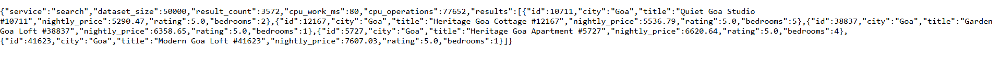

This is the browser showing the answer: JSON from the Search service, with the 50,000-listing dataset, 3,572 matches in Goa, and the first five results. It came through the AWS load balancer from a server in the Auto Scaling Group. (I shut the stack down afterwards, so the link no longer works.)

Here is the load balancer itself in the AWS console: an internet-facing **Application** load balancer, **Active**, spread over two availability zones, with its public address.

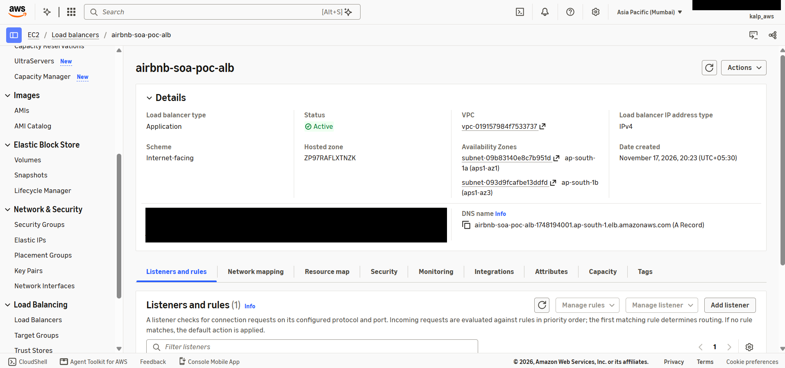

And the listener, which sends `/search` requests to the search servers:

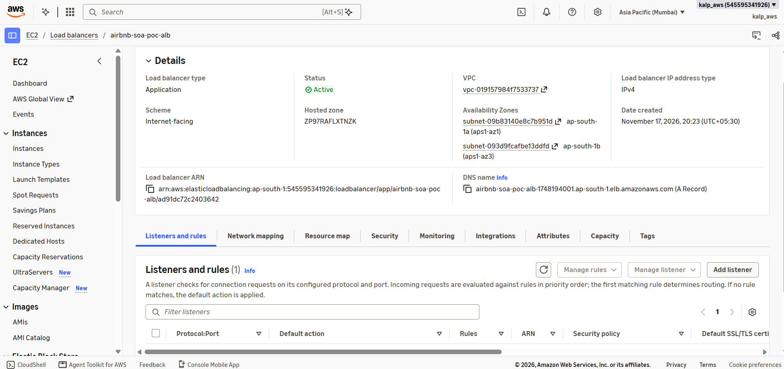

The servers behind it are listed in the *target group*. It shows a healthy target, which means the load balancer is happy to send traffic to it:

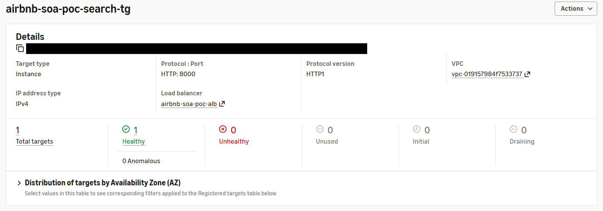

---

## 4. How I generated the load

I used **k6**, a load-testing tool. You write a small script saying what one request looks like, and k6 sends it again and again.

The important choice is *how* it decides how much to send. I used a **fixed number of requests per second, no matter what**. If the server falls behind, requests pile up and response times grow, which is exactly what a real crowd does on sale day. (The alternative, a fixed number of users who each wait for a reply, quietly hides overload because the users slow down with the server.)

Each request was `GET /search?city=Goa&max_price=8000&min_rating=3.5&limit=20`, sent from my laptop over the internet, so response times include the trip across the internet (about 130 ms even when the server is idle).

To turn "requests per second" into "people": the server only feels the request rate. If a typical person clicks about once every 10 seconds, then 16 requests per second is roughly **160 people** at the same time. That conversion is my assumption, not a measurement.

---

## 5. Test 1: how much can one server take?

I raised the traffic on one server from 5 up to 30 requests per second.

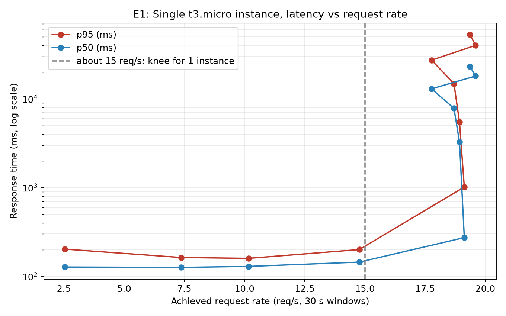

| Requests per second | Typical response | 95% of requests faster than | Errors |
|---|---|---|---|
| about 2 to 7 | 126 – 128 ms | 163 – 203 ms | none |
| about 10 | 130 ms | 160 ms | none |
| about 15 | 145 ms | 200 ms | none |
| about 19 | 273 ms | 1,015 ms | none |
| about 19, half a minute later | 3.3 s | 5.5 s | none |
| about 19, two minutes later | 18 s | 40 s | 0.7% |

**One `t3.micro` comfortably handles about 15 requests per second.** Push it past roughly 17 to 19 and the queue grows faster than the server can clear it, and response times collapse.

### And then it broke, which turned out to be useful
I deliberately went past that limit, and the server stopped answering the load balancer's health check. The Auto Scaling activity log shows what happened:

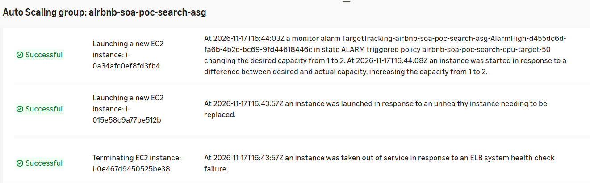

- **16:43:57** the load balancer's health check failed, so Auto Scaling **took the unhealthy server out of service**.
- **16:43:57** it **started a replacement** straight away.
- **16:44:03** the CPU alarm went off and raised the target from 1 to 2 servers.

So even a failure was handled automatically. (I didn't use this run for the main graph, because it mixes overload and failure.)

---

## 6. Test 2: a traffic spike, the main result

Starting from **one server**, I sent 4 requests per second for 2 minutes, ramped up to **16 per second** (just above what one server can take), held that for 10 minutes, then dropped back to 4 and waited to see what happened. Start: 17:02. End: 17:37.

### The graph: response time against number of servers

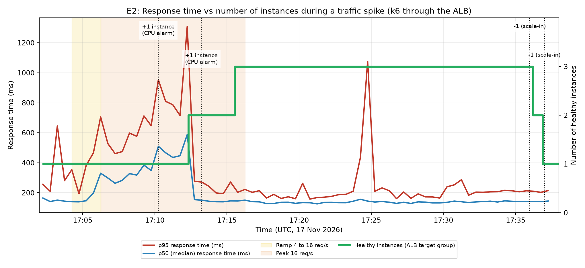

How to read it: the **green line** is how many healthy servers were behind the load balancer (right-hand scale). The **red line** is the response time that 95% of requests beat, and the **blue line** is the typical (median) response time (left-hand scale, milliseconds). The dotted vertical lines are the moments Auto Scaling added or removed a server.

What it shows, in order:

1. With **one** server and the load climbing, response times drift up to about 1.3 seconds.
2. At 17:10 a second server is added. Once it passes its health check (about 17:12), response times **drop straight back to about 270 ms**.
3. A third server joins at 17:13.
4. After the traffic stops, the extra servers are removed at 17:36 and 17:37, back down to one.

### The same thing in numbers (at the peak, about 16 requests per second)

| Healthy servers | Typical response | Slow responses (95th percentile) |
|---|---|---|
| 1 | 366 ms | **680 ms** (worst window 1,308 ms) |
| 2 | 145 ms | **257 ms** |
| 3 | 145 ms | **203 ms** |

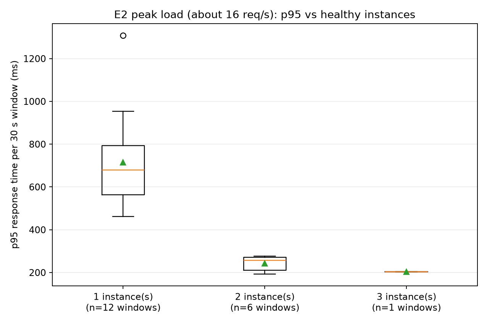

### Why it scaled: the CPU

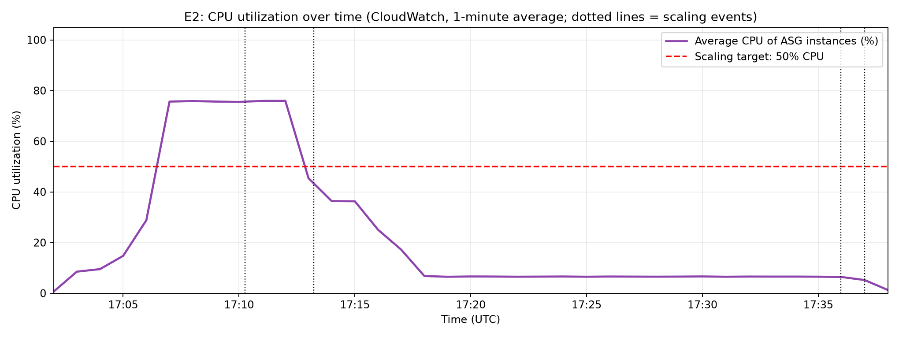

With one server, CPU sat at about **76%**, well above the **50%** line. That is what set off the alarm.

### Servers launching by themselves: the key screenshot

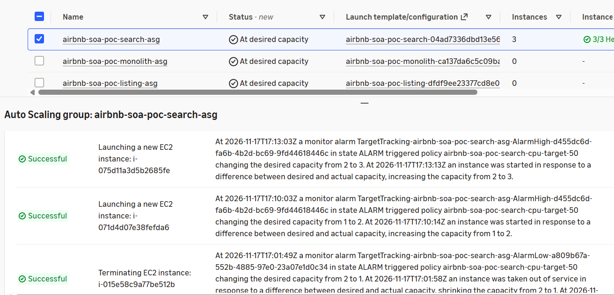

This is the Auto Scaling group's own activity log, showing **3 servers, all healthy**. Reading it from the bottom up:

- **17:01:49** the "AlarmLow" alarm removed a server (2 to 1), left over from Test 1.
- **17:10:03** the "AlarmHigh" alarm went off, and the policy changed the wanted number of servers **from 1 to 2**. The new server started at 17:10:14.
- **17:13:03** the same alarm changed it **from 2 to 3**. That server started at 17:13:13.

Every row states its cause: an alarm triggering the scaling policy. Nobody launched these by hand.

### The rule behind it: 50% CPU

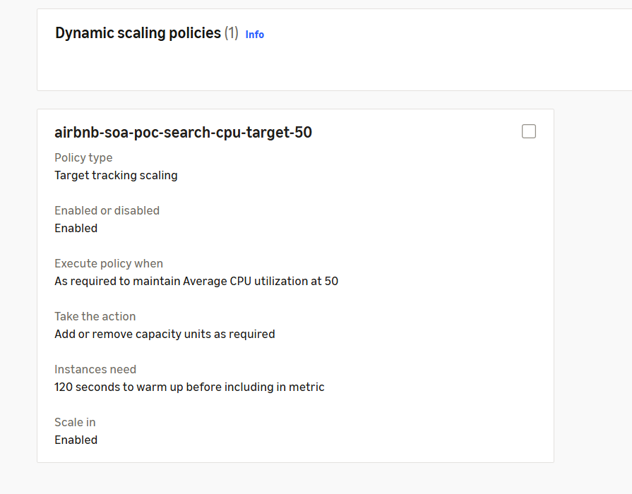

The policy is a *target tracking* policy: "maintain Average CPU utilization at **50**", with a 120-second warm-up so that a new server isn't counted before it can serve.

### The group's own charts

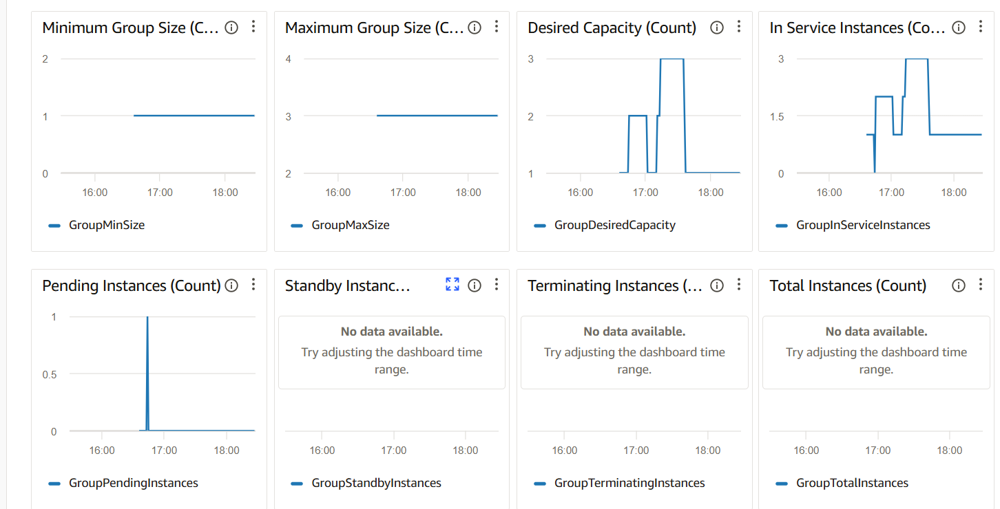

CloudWatch's view of the same events: the minimum stays at 1, the maximum at 3, and the wanted capacity and the in-service servers rise to 2 and 3 and fall back to 1.

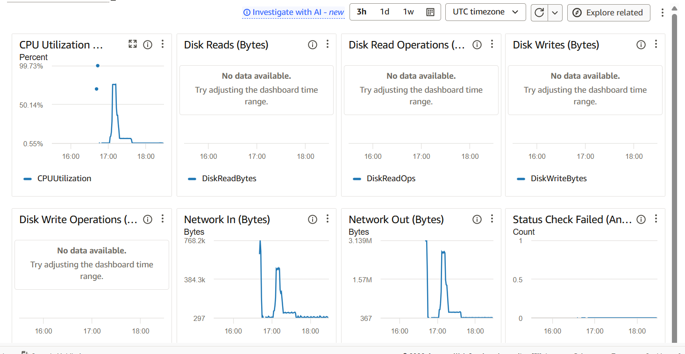

CPU for the group's servers in the console: it climbs during the tests and drops back to almost nothing afterwards.

### The alarms AWS created

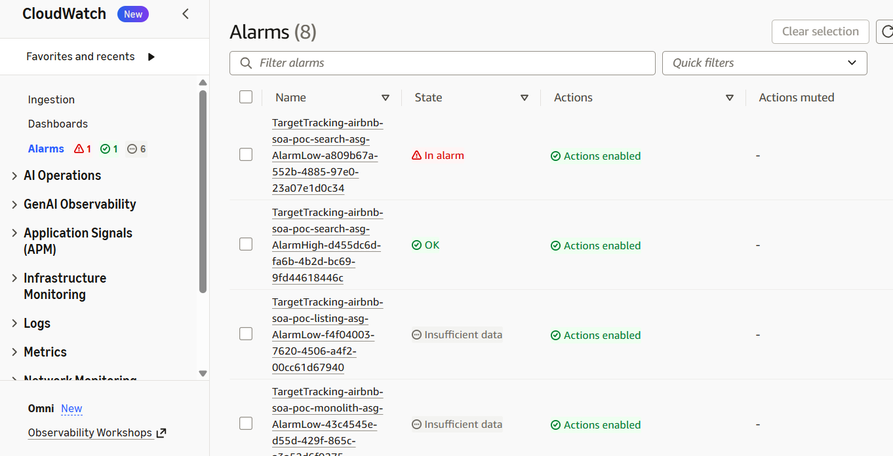

Target tracking creates a pair of alarms for each group: **AlarmHigh** (add a server) and **AlarmLow** (remove one). For the search group, AlarmHigh is "OK" and AlarmLow is "In alarm", which is exactly right after scale-in: CPU is low, so no extra capacity is wanted. The listing and monolith groups say "Insufficient data" because they run no servers. I didn't write these alarms; AWS created them from the policy.

### A few things I noticed

- **It isn't instant.** CPU crossed 50% at about 17:07 but the second server only started helping around 17:12. AWS waits for several high readings in a row, then the new server has to start up, download the image and pass two health checks. During that gap people got the slower responses.
- **Scale-in is slow on purpose.** The extra servers went away about 19 minutes after the traffic dropped. AWS waits to be sure the quiet is real, so it doesn't add and remove servers in a loop.
- **For a sudden spike you would add servers before the event.** The Terraform in this project has a scheduled "pre-warm" mode for that, which I didn't test.

Overall for this run: **16,679 requests, only 2 failed (0.01%)**, typical response 160 ms, 95th percentile 623 ms.

---

## 7. The same idea with Docker and Nginx

I also built the same behaviour on my own laptop, with **Nginx as the load balancer** instead of the AWS one.

**Docker has no autoscaler of its own.** It can start any number of copies of a container, but nothing in Docker decides how many. So I wrote a small script, `scripts/docker-autoscaler.sh`, that does the job the Auto Scaling Group does on AWS. Every 10 seconds it reads each container's CPU, works out `ceil(current containers × CPU% ÷ 50)`, and starts or stops containers to match (between 1 and 5). Nginx finds the new containers because Docker's internal name `search` points at *every* running copy, and Nginx re-checks that name every 2 seconds (`docker/nginx.autoscale.conf`).

| | AWS | Docker on my laptop |
|---|---|---|
| Load balancer | AWS Application Load Balancer | Nginx container |
| What gets scaled | EC2 servers | Containers (0.6 CPU each) |
| Who decides how many | The Auto Scaling Group | My script |
| Checks servers are alive | Yes | No |
| Handles a server being removed | Drains connections first | Can briefly send a request to a removed container |

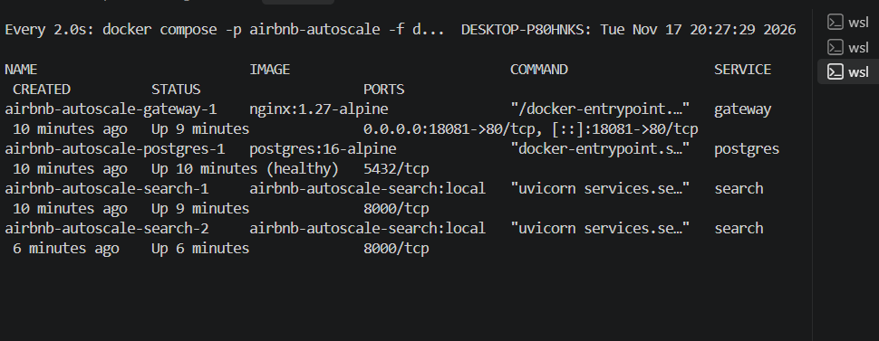

This is `docker compose ps` while it ran: the **Nginx gateway**, **postgres**, and two search containers, with `search-2` started by the script a few minutes after `search-1`.

I ran two tests, at 5 and at 8 requests per second:

| Run | Peak | Containers over time | Requests | Failures | Typical | 95th percentile |
|---|---|---|---|---|---|---|
| 1 | 5 per second | 1 → 2 → 3 → 2 → 3 → 1 | 2,249 | 0 | 101 ms | 126 ms |
| 2 | 8 per second | 1 → 2 → 3 → 4 → 1 | 3,284 | 0 | 101 ms | 154 ms |

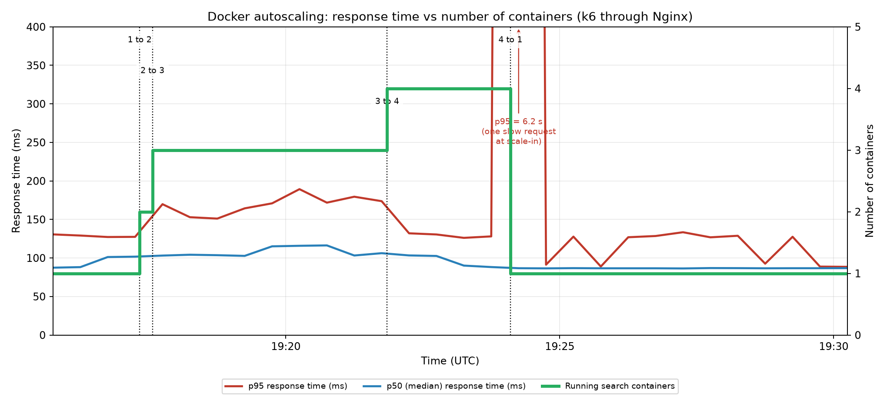

The containers were added when CPU went above 50% and removed after the load fell, and nothing failed. The speed-up is small, because my laptop is fast and even one container coped. The big slow-then-recover effect is the AWS test above, where a small server really was overwhelmed.

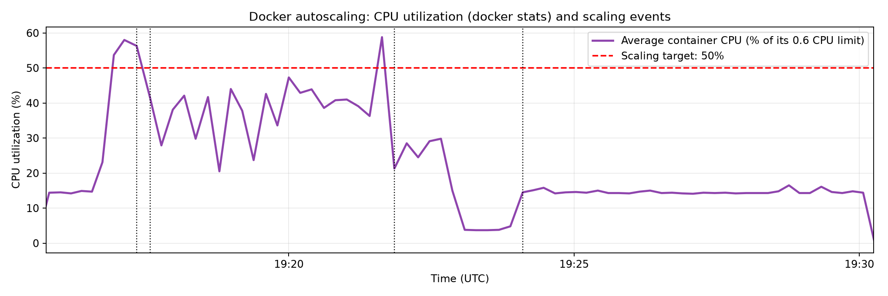

---

## 8. What this shows

- **Servers were added automatically when CPU went above 50%.** Test 2 shows instances launching, with the alarm named as the cause, in the AWS console.
- **Response time fell as servers were added:** about 680 ms with one server against about 257 ms with two, at the same traffic.
- **Servers were removed automatically when traffic dropped.**
- **A failing server was replaced automatically** (Test 1).
- **The same behaviour can be rebuilt with Docker and Nginx**, with a small script standing in for the Auto Scaling Group.

Everything is in the repository: the application in `services/`, the infrastructure in `infra/terraform/`, the load tests in `loadtest/k6/`, the Docker demo in `docker/`, and the graphs and screenshots in `reports/figures/` and `screenshots/`.
